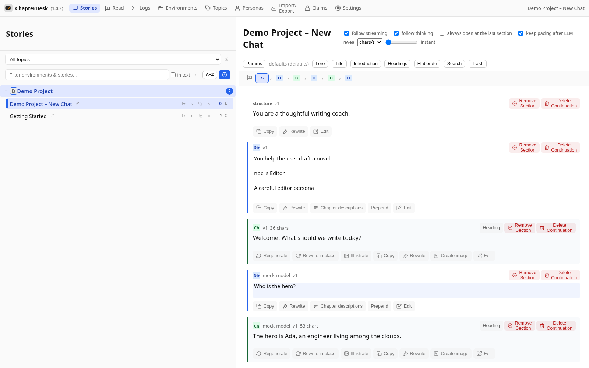
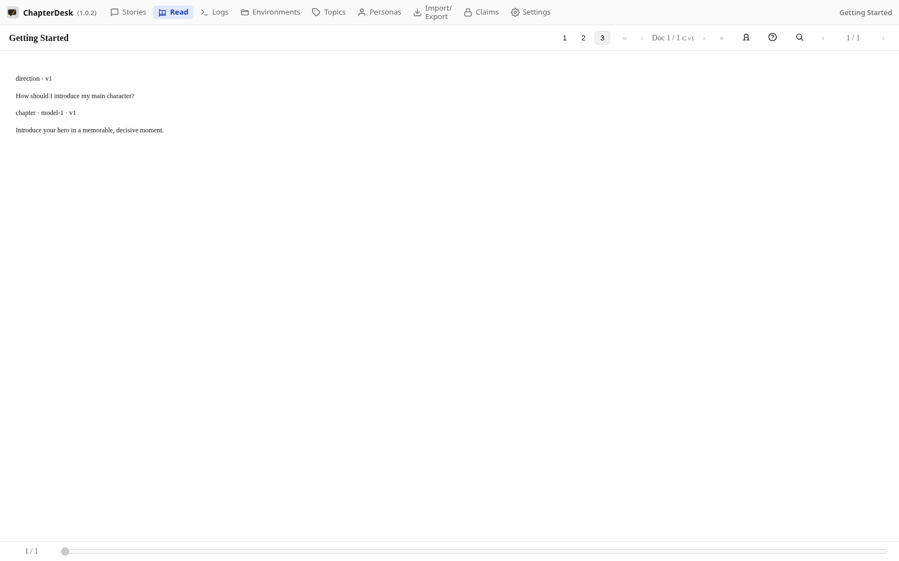
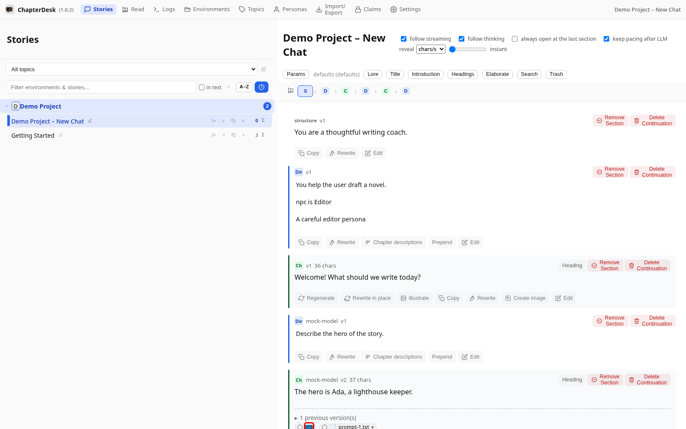

# ChapterDesk

**A local writing studio for scene-by-scene story work with language models.**

You do not chat with the model.  
You give a short direction for the next scene, read what comes back, and keep going.

When a plot could go two ways, you fork the thread and keep both versions.  
When you want to read, you open the book view instead of the prompt.

ChapterDesk is for **steering stories** — not for claiming authorship.  
The model drafts the beat; you decide what happens next.


---

## What it is for

- Direct a scene in a few lines, then read the result
- Keep topics, environments, and personas as the spine of a longer work
- Branch a draft when a scene could go another way
- Reread the active path as a continuous text
- Stay local: your data lives in SQLite on your machine (or IndexedDB in the browser)

The Angular client talks only to a local **chat-server**. The server stores threads and versions, proxies provider requests, and exposes a small REST API.

---

## A quick look

| Steering & branching | Read as a book |
|---|---|
| Give a short direction, the chapter streams back; fork any beat to keep both versions. | Switch to the book view to read the active path as continuous prose. |
|  |  |

Scenes can also be **illustrated**, so chapters keep their visual anchors next to the text:



## Words on the screen

Code and URLs still say project / chat / question / answer.  
What you see in the UI:

| In the UI       | Means                                                                 |
|-----------------|-----------------------------------------------------------------------|
| **Topic**       | A body of work, plus the standing narrator rules (system prompt)      |
| **Environment** | A general setting-idea inside that topic: place, tone, who tends to be there |
| **Story**       | One narrative thread you can fork                                     |
| **Direction**   | The cue you give for the next beat                                    |
| **Chapter**     | The draft that comes back                                             |

---

## How it feels to use

1. You set the room once (Topic rules + Environment + Personas).
2. You open a Story and give a short **Direction**.
3. A **Chapter** streams back.
4. You read it, then steer again — or branch if you want to explore another path.
5. Whenever you want to just read, you switch to the Book view.

There is no long conversation history to manage. The active path is always clear.

---

## Core ideas

- **Local first** — Your stories and settings stay on your machine. The app talks only to a local server; the server is what calls your chosen model provider.
- **Steering, not chatting** — You direct scenes. The model continues them. You stay in control of what happens next.
- **Branching built in** — When a moment could go two ways, keep both versions instead of overwriting.
- **Organized for longer work** — Topics, Environments, and Personas give structure without forcing you into a rigid outline.
- **Read as a book** — Switch from the steering view to a continuous reading view of the active path at any time.

---

## What you need

ChapterDesk does not ship a model. You bring a provider that speaks the OpenAI-style chat API (OpenRouter is the usual choice — one key, many models).

A long-context, instruction-following model is enough. You are giving scene directions, not running a toolbox agent.

---

## First hour

ChapterDesk does not ship a model. You bring a provider key, pick a model, then set the room the story happens in.

### 1. API token

You need an API token from a provider that speaks the OpenAI-style chat API.

[OpenRouter](https://openrouter.ai/) is the usual choice: one key, many models. DeepSeek (including Pro), GLM, Kimi, Claude Sonnet, and Grok are available there or from the vendor’s own endpoint.

In **Settings → Providers** add the provider (name, base URL, token).  
For OpenRouter the base URL is `https://openrouter.ai/api/v1`.

Keep the token on this machine. ChapterDesk only talks to your local server; the server is what calls the provider.

See [Settings: Appearance, Providers, Tasks and Prompts](https://github.com/aschoerk/chapterdesk/wiki/settings).

### 2. Choose a model

Still in **Settings**, fetch the provider’s catalog and enable the models you actually want. Mark one as a preset if you use it all the time.

A long-context, instruction-following model is enough. You are giving scene directions, not running a toolbox agent.

### 3. Topic rules, environment, personas, first direction

The **Topic** holds how the narrator writes. The **Environment** only says what kind of place this is.

1. Open **Environments**. Create a **Topic** and paste the system prompt from the section below into the topic’s default system prompt.  
   See [Organize with topics](https://github.com/aschoerk/chapterdesk/wiki/topics).
2. Create an **Environment** in that topic. Do not paste the long narrator rules again. Write a short setting-idea: where we are in general, the mood, the kind of people who show up. Leave room for many stories.  
   See [Books (Environments) and moving stories](https://github.com/aschoerk/chapterdesk/wiki/environments).
3. Create the **Personas** that belong here and attach them to the environment. They are who the narrator may speak for.  
   See [Personas](https://github.com/aschoerk/chapterdesk/wiki/personas).
4. Open **Stories** and start a story in that environment.  
   See [Write Your First Chapter](https://github.com/aschoerk/chapterdesk/wiki/new-story).
5. The first **Direction** is the Situation: this hour, these people, this pressure. Then read the **Chapter**. Later directions only steer.  
   When you want to just read, switch to the [Book view](https://github.com/aschoerk/chapterdesk/wiki/reader).

Environment example (setting-idea, not a scene):

```text
A provincial night-train line that never quite reaches the capital.
Second-class compartments, weak tea, letters people should have sent.
Quiet, slightly wrong, no rush to explain the world.
```

Situation example (first direction of one story):

```text
Night train, second-class compartment. Mara has the window seat and a
folded letter she has not opened. A conductor passes and does not stop.
Begin with the letter. Do not skip to the destination.
```

### Example topic system prompt

Paste this into a topic’s default system prompt if you want ChapterDesk to direct scenes and keep them open for the next cue.

```text
You are a collaborative narrator for this topic. The user gives scene directions. You continue the scene. You do not lecture, summarize the assignment, or break character unless asked.

Keyword / hint handling
- Take the intent of a hint, then write it in new wording, action, and dialogue.
- Do not echo the user's exact phrases or labels back at them.

Descriptive variety
- Do not reuse full sentences or blocks from earlier turns.
- Rotate focus: sight, sound, smell, touch, temperature, motion, emotion.
- Re-describe a place, body, or mood only when it has changed, and then with fresh prose.

Response freshness
- Each answer must move the scene forward.
- Prefer active voice and short concrete sentences.
- Mix close first-person narration with third-person on the world and other characters when that keeps the beat clear.

Keep the scene open
- Stay inside the scene the user started.
- Do not wrap up, time-skip, fade to the next day, or send everyone home unless the user asks.
- End on an unfinished beat — a look, a line, a choice — so the user can steer the next direction.

Length and pace
- Write a full scene beat, not a sketch. Aim for a long, detailed passage.
- After the draft is already long, do not rush to a conclusion. Stop mid-action.

Collaboration
- If the user offers a persona or a hint, use it.
- You may speak or act that persona when the user allows it.
- The user can override or correct at any time. Follow the correction from then on.
- A line that starts with (REMINDER: …) is a standing rule. Apply it immediately and keep it.

Tone for this topic
- Immersive, specific, consequence-aware.
- No lecture, no meta recap, no “as an AI.”
- Keep the work readable in public: no explicit sexual content. Tension, conflict, and complicated motives are fine.
```

---

## Learn more

The searchable documentation site — the full user manual, walkthrough videos,
and developer docs — is published at
**[https://aschoerk.github.io/chapterdesk/](https://aschoerk.github.io/chapterdesk/)**.

The getting-started guide and detailed feature pages are also mirrored in the [Wiki](https://github.com/aschoerk/chapterdesk/wiki):

- [Getting Started with ChapterDesk](https://github.com/aschoerk/chapterdesk/wiki/welcome)
- [Organize with topics](https://github.com/aschoerk/chapterdesk/wiki/topics)
- [Books (Environments) and moving stories](https://github.com/aschoerk/chapterdesk/wiki/environments)
- [Personas](https://github.com/aschoerk/chapterdesk/wiki/personas)
- [Write Your First Chapter](https://github.com/aschoerk/chapterdesk/wiki/new-story)
- [Continuations and the navigation bar](https://github.com/aschoerk/chapterdesk/wiki/continuations)
- [Read your story as a book](https://github.com/aschoerk/chapterdesk/wiki/reader)
- [Illustrate your chapters](https://github.com/aschoerk/chapterdesk/wiki/illustrate)
- [Section actions and the context menu](https://github.com/aschoerk/chapterdesk/wiki/node-actions)
- [Settings: Appearance, Providers, Tasks and Prompts](https://github.com/aschoerk/chapterdesk/wiki/settings)
- [Delete and Restore Sections](https://github.com/aschoerk/chapterdesk/wiki/trash)

---

## Download & Run

### Linux (AppImage / .deb / .rpm)

1. Go to the [Releases](https://github.com/aschoerk/chapterdesk/releases) page
2. Download one of:
   - `.AppImage` (run anywhere)
   - `.deb` (Debian / Ubuntu / Mint …)
   - `.rpm` (Fedora / RHEL / openSUSE …)
3. Make the AppImage executable and start it:

```bash
chmod +x ChapterDesk-*.AppImage
./ChapterDesk-*.AppImage
```

Or install the package with your distro tooling:

```bash
# Debian/Ubuntu
sudo apt install ./ChapterDesk-*.deb
# Fedora
sudo dnf install ./ChapterDesk-*.rpm
```

The application starts its own local server automatically.  
Your data is stored in:

```
~/.config/ChapterDesk/data/chapterdesk.sqlite
```

Linux package metadata (AppStream, desktop file, recipes for Flathub / OBS / PPA / AUR) lives in the `packaging/` folder — see [`packaging/README.md`](packaging/README.md).

### Windows

1. Go to the [Releases](https://github.com/aschoerk/chapterdesk/releases) page
2. Download the latest Windows installer (`ChapterDesk Setup *.exe`, NSIS)
3. Run the installer. You can choose the folder; it is not a one-click-only install.
4. Start **ChapterDesk** from the Start menu or the desktop shortcut.

The application starts its own local server automatically.  
Your data is stored in:

```
%APPDATA%\ChapterDesk\data\chapterdesk.sqlite
```

If Windows Defender SmartScreen warns about an unknown publisher, choose **More info** → **Run anyway**. The build is unsigned unless a code-signing certificate is added. To sign the NSIS build, add `CSC_LINK` (the `.pfx` as base64 or URL) and `CSC_KEY_PASSWORD` as GitHub secrets — the [release workflow](.github/workflows/release.yml) forwards them automatically.  
See [`packaging/README.md`](packaging/README.md) for the Microsoft Store (MSIX) path (`npm run electron:build:msix`).

To build the installer yourself on Windows:

```bash
npm install
npm install --prefix chapterdesk-api-server # bundled API server dependencies
npm run electron:build
```

The `.exe` installer is written to the `dist/` folder.

---

## Development

### Prerequisites

- Node.js 22+
- npm

### Setup

```bash
git clone https://github.com/aschoerk/chapterdesk.git
cd chapterdesk
npm install
npm install --prefix chapterdesk-api-server # bundled API server dependencies
```

### Run in development mode

```bash
npm run electron:dev
```

This starts:

- the Angular development server (`ng serve`)
- the Electron shell
- the local chat-server

### Build Linux packages / Windows installer

```bash
npm run electron:build
```

> The bundled API server (`chapterdesk-api-server`) is a separate npm package.  
> Install its dependencies once before building if you have not already  
> (`npm install --prefix chapterdesk-api-server`).

On Linux this produces `.AppImage`, `.deb` and `.rpm` in `dist/`. On Windows it produces the NSIS `.exe` installer. Useful extras:

```bash
npm run electron:build:dir     # unpacked dir only (fast size/smoke check)
npm run electron:build:msix    # Windows: MSIX package for the Microsoft Store
```

The installer is kept slim by construction: only the resolved production dependencies are bundled (Angular is a devDependency — the renderer ships as a prebuilt static bundle). Progress on official-distro and Windows certification is tracked in [`packaging/README.md`](packaging/README.md).