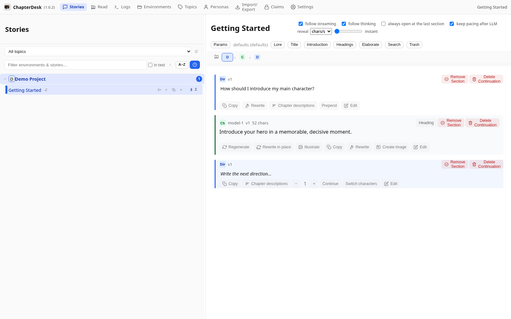
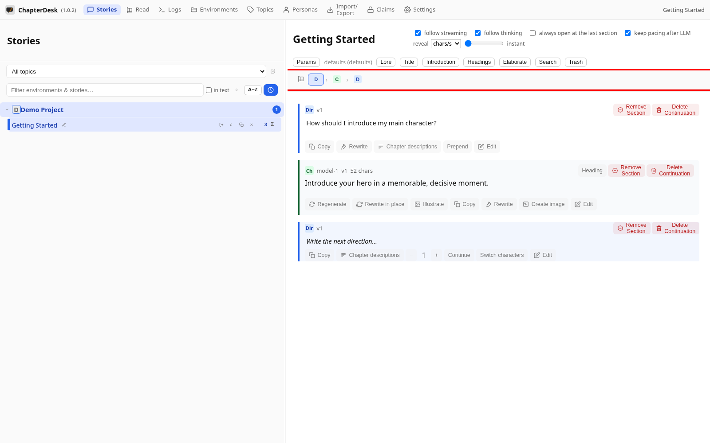
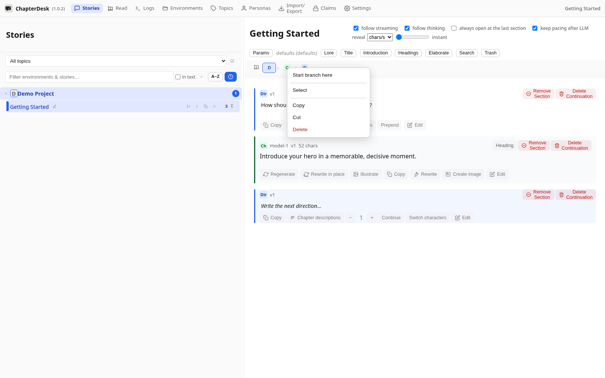
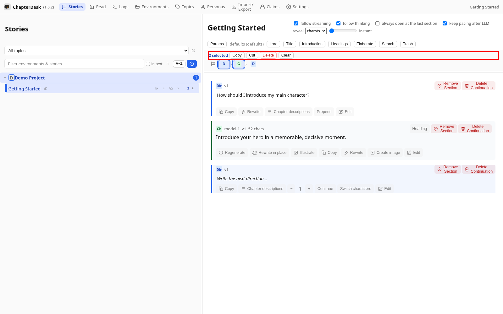

# Continuations and the navigation bar

> Auto-generated on 2026-10-26

## Step 01: Open a story

Open the seeded **Getting Started** story.

## Step 02: See the navigation bar

The **navigation bar** shows the active path: direction (**D**), chapter (**C**), then the next direction. Click a button to jump to that section.

## Step 03: Open a section context menu

Right-click a section to rename, copy, edit or branch a continuation from it.

## Step 04: Multi-select sections

Hold **Ctrl** and click several navigation buttons to select a contiguous chain — the toolbar copies, cuts, deletes or clears the selection.

