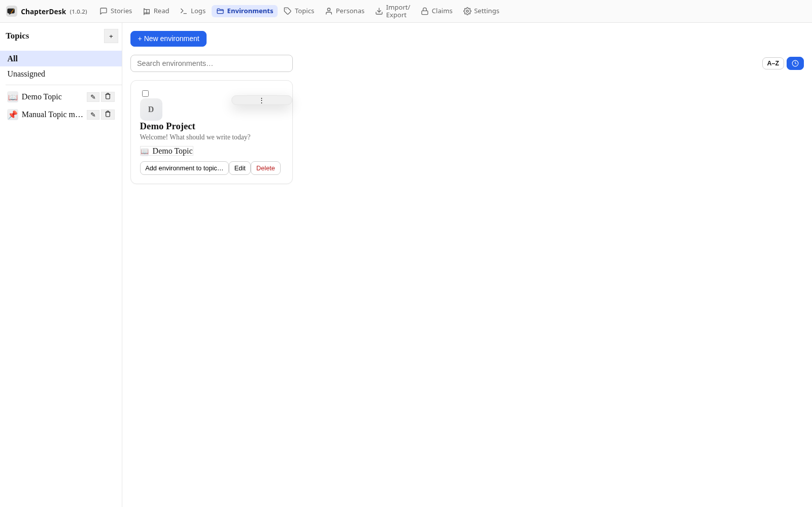
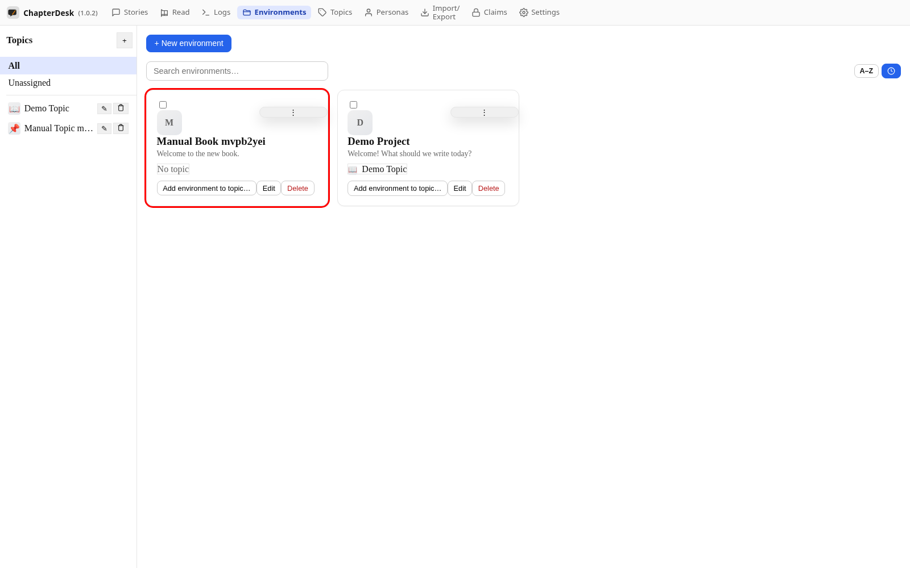
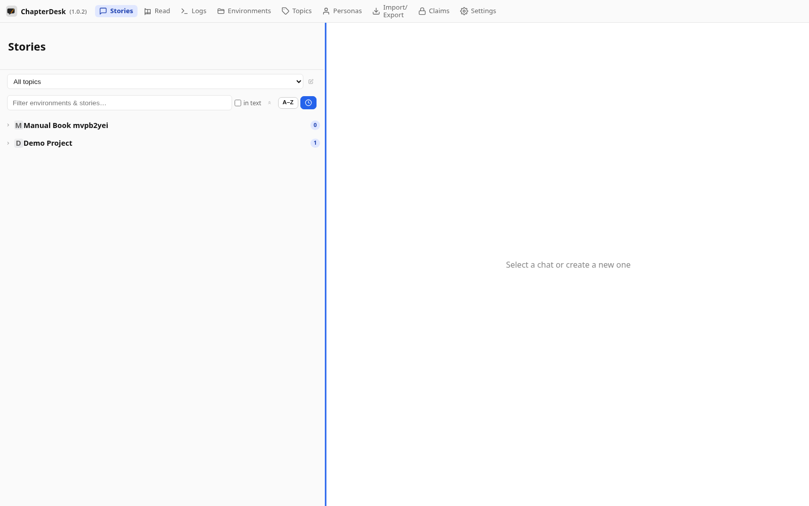
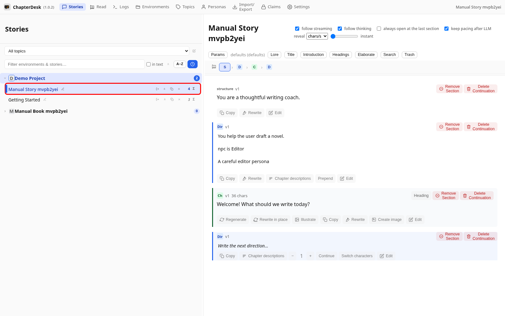
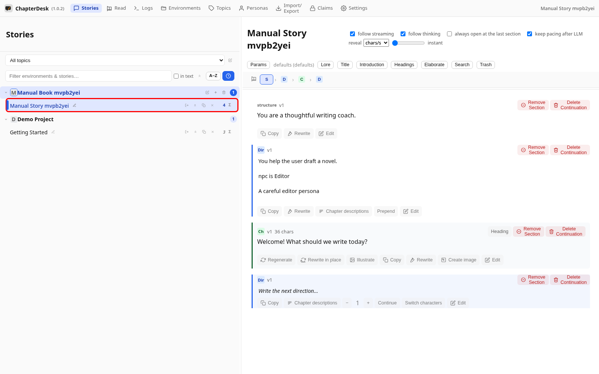

# Books (Environments) and moving stories

> Auto-generated on 2026-10-26

## Step 01: Open the Environments page

Use the **Environments** link in the top navigation. Environments are your books; each groups stories that belong together.

## Step 02: Create a book

Click **+ New environment**, give it a name and choose a main topic. Save to create the book.

## Step 03: Back to the stories sidebar

Return to **Stories**. The new book appears under its topic in the sidebar.

## Step 04: Create and name a story

Create a new story in **Demo Project** and rename it so it is easy to find.

## Step 05: Move the story into the book

Open the story’s **Move to another environment** menu and pick the new book. The story is reassigned and now appears in that book.

