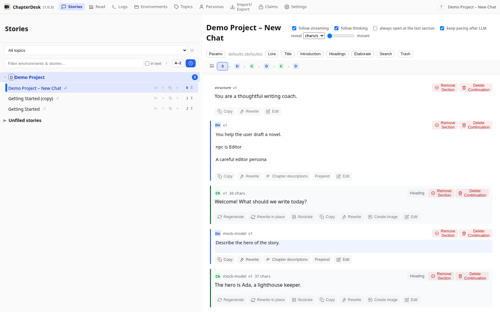
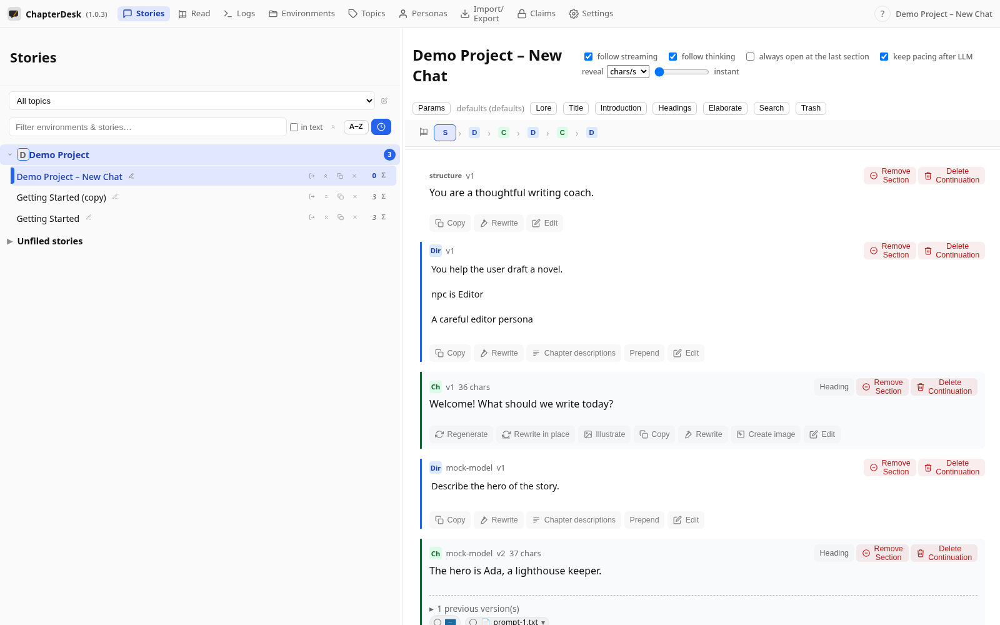
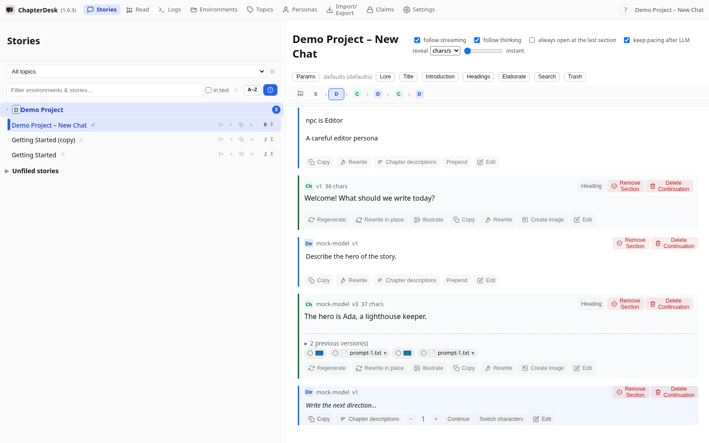

# Illustrate your chapters

> Auto-generated on 2026-10-28

The **Illustrate** action attaches a generated picture to a chapter.
You can illustrate the whole chapter or select a marked part of the text to
depict exactly that moment.

This manual generates a picture for a chapter and then for a selected passage.

## Step 01: Open a story

Create a fresh story and ask a direction. The mock model writes a short chapter.

## Step 02: Open Illustrate

On the chapter card, click **Illustrate**. The dialog lets you choose the model, the story context and the number of pictures.

## Step 03: See the generated picture

When the model returns an image it is attached to the chapter as a thumbnail — shown in the tree and exported with the story.

## Step 04: Illustrate a marked part

Select a part of the chapter text and press **Illustrate** again: the dialog pre-fills **Scene to depict** with the marked text (editable). The picture then shows exactly that marked moment — in every use case (planned / direct / pure).

