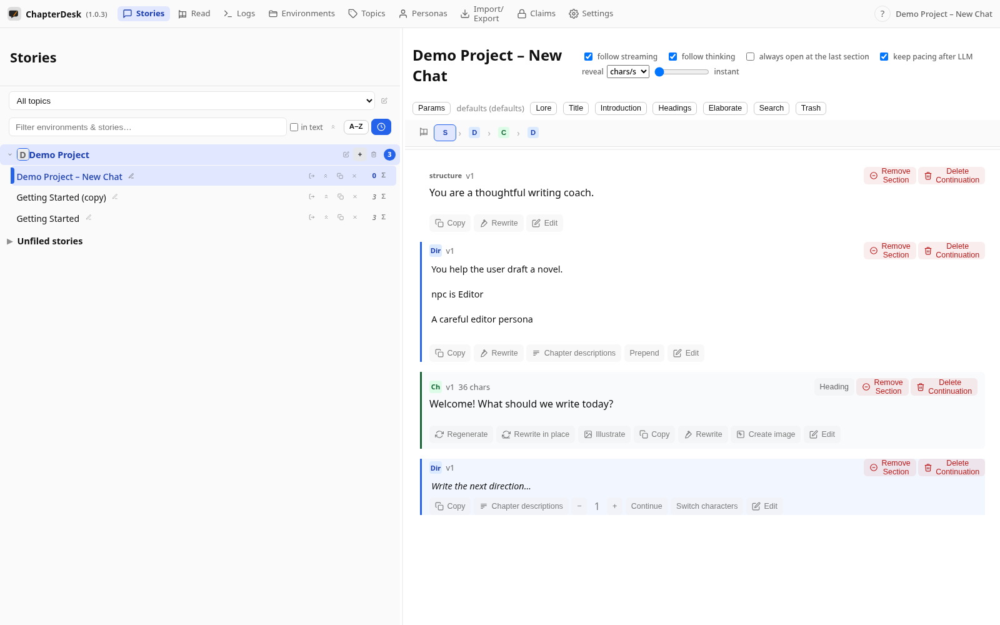
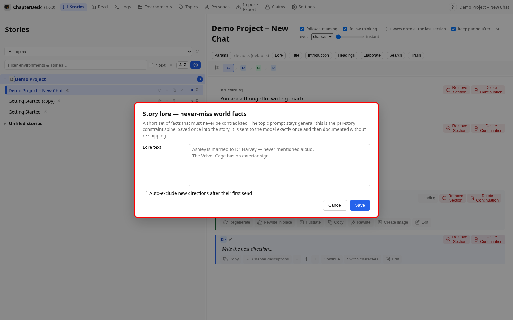
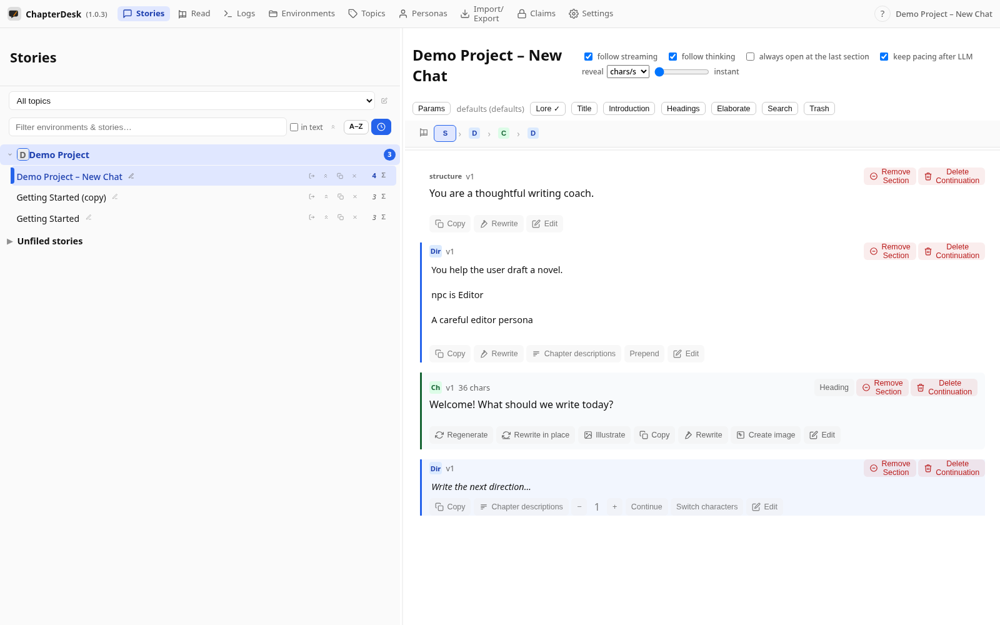
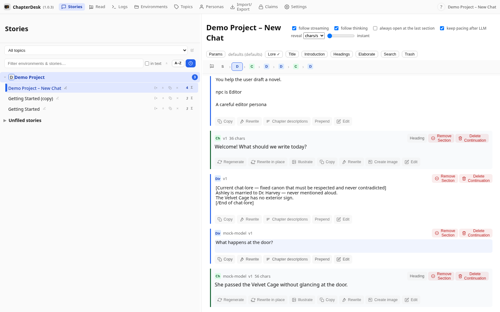

# Story lore — canon for every prompt

> Auto-generated on 2026-10-28

**Lore** is a short set of never-miss world facts the model must
respect and never contradict. It is stored per story and inserted in front of
every new direction when the prompt is sent — sent exactly once, then
documented, so it never repeats and never clutters the context.

This manual sets up lore for a fresh story and shows it travel with a prompt.

## Step 01: Open the application

Launch ChapterDesk. Your books and stories are listed in the left sidebar.

## Step 02: Open a fresh story

Click **New story** in a book. ChapterDesk opens an empty story with a composer at the end.

## Step 03: Open the Story Lore dialog

The **Lore** button in the toolbar opens the per-story lore dialog. Lore is a short set of never-miss world facts the model must respect and never contradict.

## Step 04: Enter the lore text

Type the facts that must always hold, then **Save**. The toolbar now shows **Lore ✓**. **Auto-exclude new directions after their first send** keeps the chat lean by sending each new direction once and then removing it from the history the model sees.

## Step 05: Send a direction

Write the next direction and press **Ctrl+Enter**. Just before the prompt is sent, the lore is materialized as its own node right in front of the direction, wrapped in canon markers so the model treats it as fixed lore.

## Step 06: Lore travels with the prompt, then documents itself

The answer streams in as a new chapter. The lore node stays in the tree — it was sent **exactly once** with the direction, then documented (excluded from later context) so it never repeats and never clutters the prompts.

