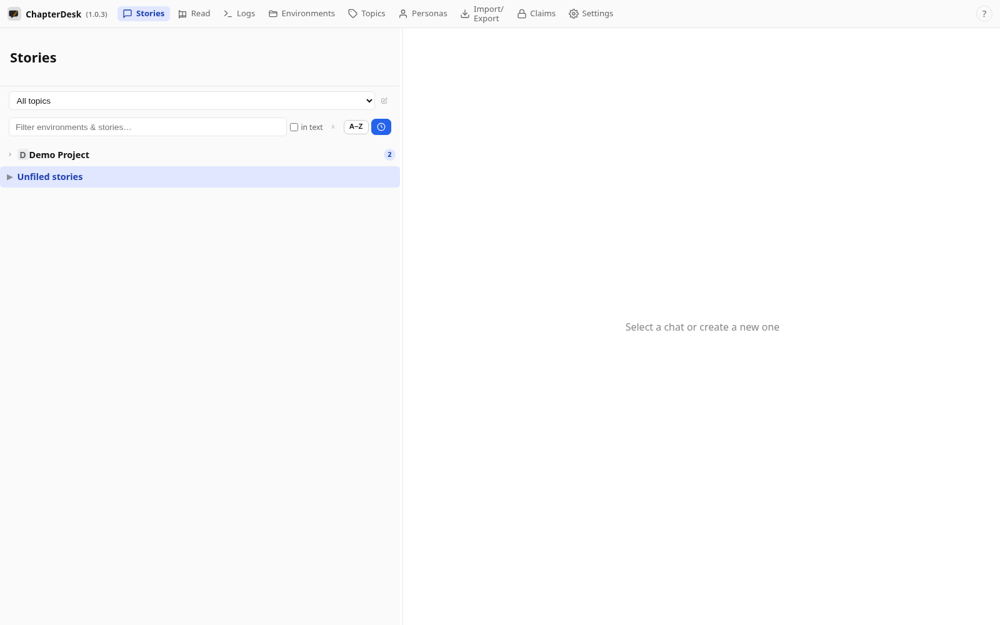
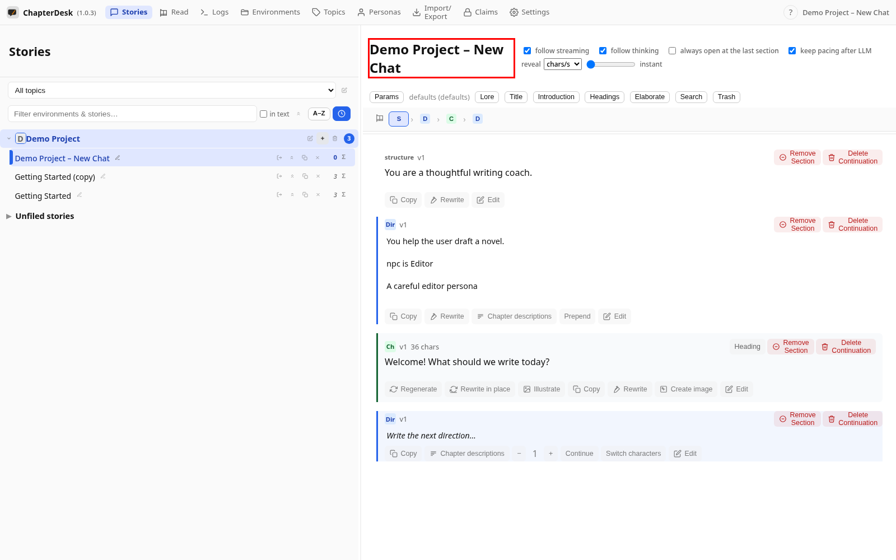

# Write Your First Chapter

> Auto-generated on 2026-10-28

Writing a story is a dialogue: you give a **direction** — what
should happen next — and ChapterDesk streams the next **chapter**. Directions
and chapters alternate down the page and form the story tree.

This manual creates a fresh story and writes the first chapter.

## Step 01: Open the application

Launch ChapterDesk. Your books and stories are listed in the left sidebar.

## Step 02: Create a new story

Click **New story** in your book. ChapterDesk opens a fresh story with a welcome section.

## Step 03: Write a direction

Click the composer at the end of the story and type what should happen next, then press **Ctrl+Enter**.

## Step 04: Read the answer

The model streams its reply into a new chapter beneath your direction.

