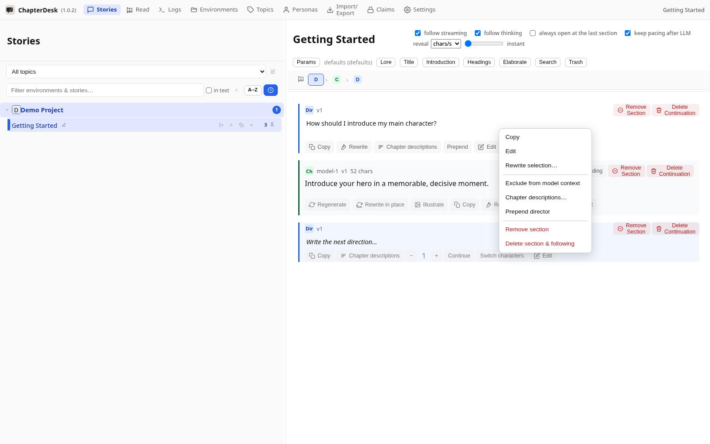
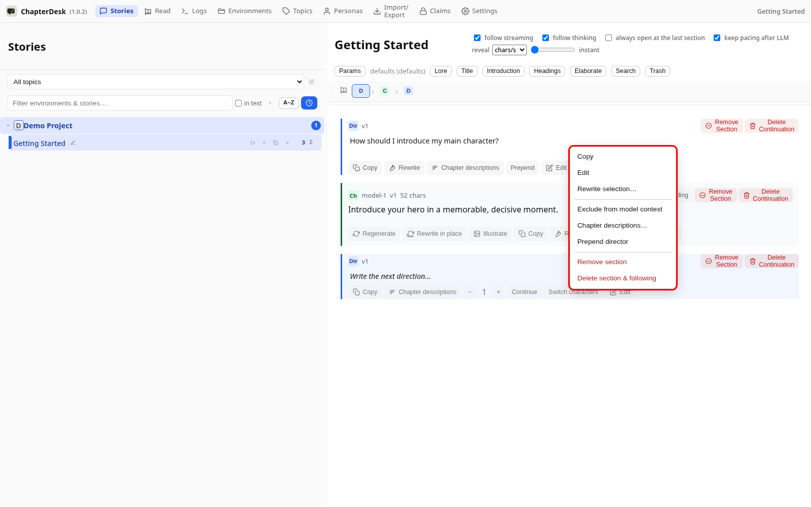
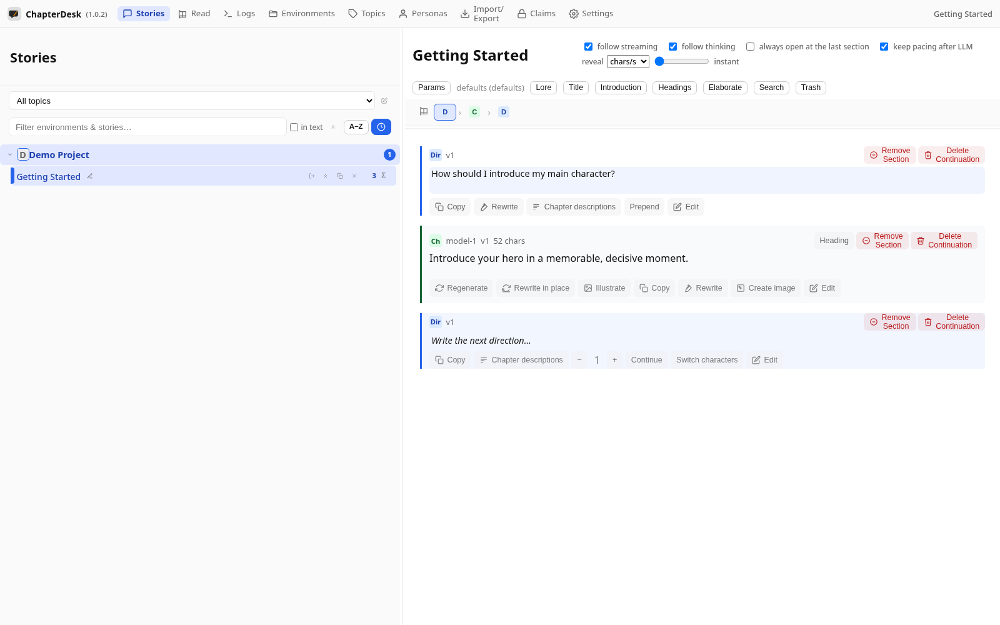

# Section actions and the context menu

> Auto-generated on 2026-10-26

## Step 01: Open a story

Open the seeded **Getting Started** story.

## Step 02: Right-click a section

Right-click any section to open its context menu.

## Step 03: See the section actions

The menu offers common actions: **Copy**, **Edit**, **Rewrite**, **Exclude from model context**, **Remove section** or **Delete section & following**.

## Step 04: Close the menu

Click outside (or press Escape) to dismiss the menu without changing anything.

