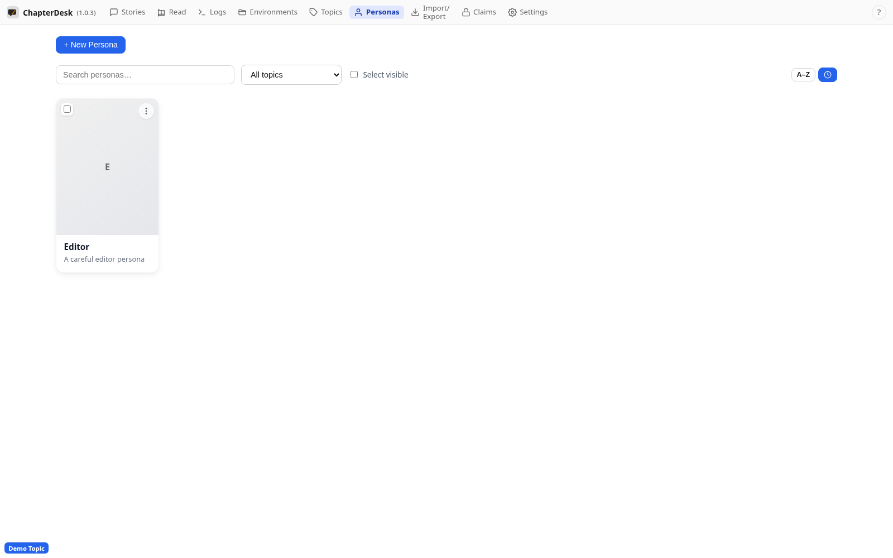
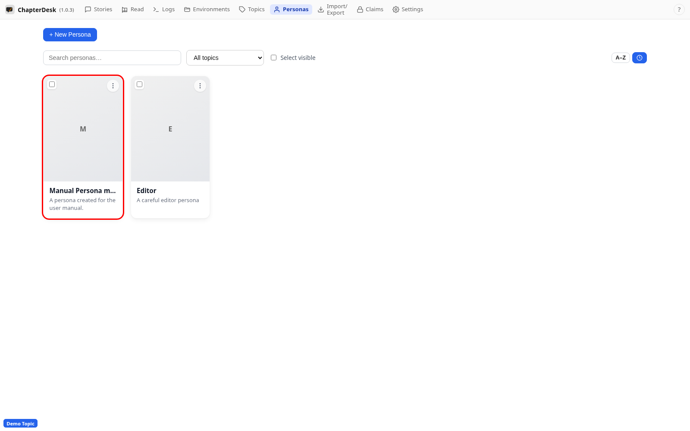
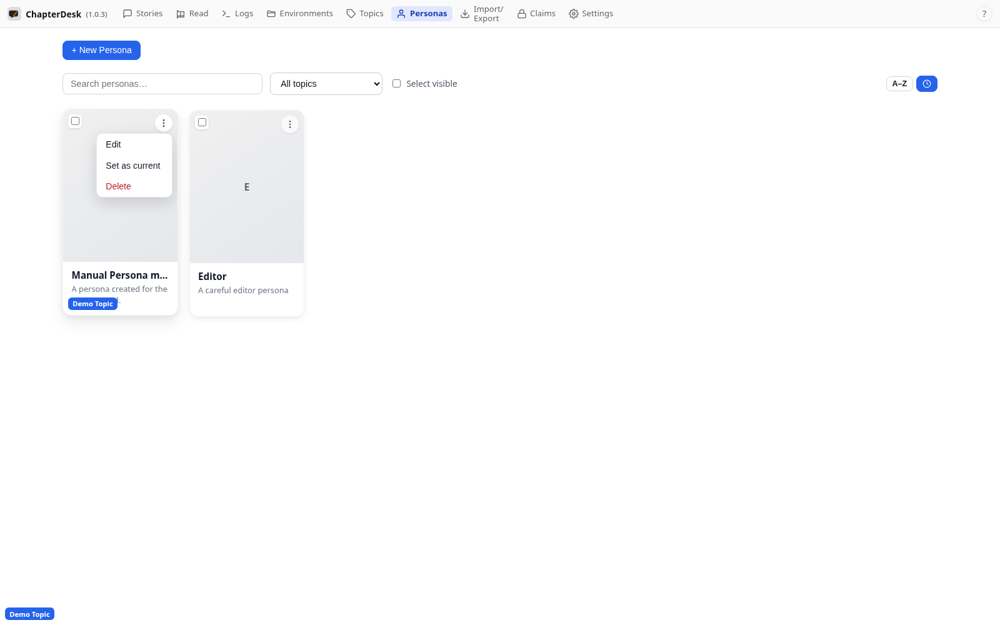

# Personas

> Auto-generated on 2026-10-28

**Personas** are writing voices / narrators you can attach to
environments. Each persona can be created, edited and set as the current
persona.

This manual creates a persona and reviews it.

## Step 01: Open the Personas page

Use the **Personas** link in the top navigation. Personas are writing voices / narrators you can attach to environments.

## Step 02: Create a persona

Click **+ New persona**, enter a name, short name and choose its main topic, then save.

## Step 03: Review the persona

The persona card shows its name and description. The card menu lets you edit, delete or set it as the current persona.

