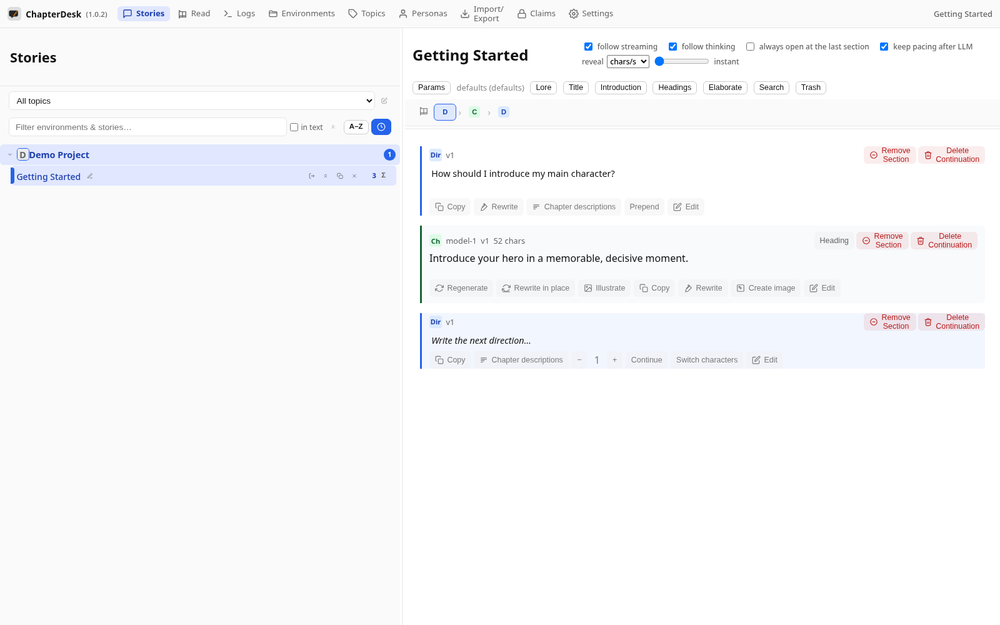
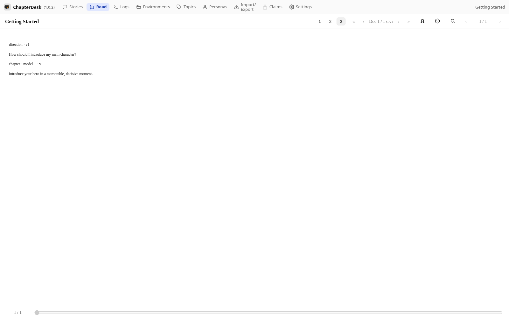
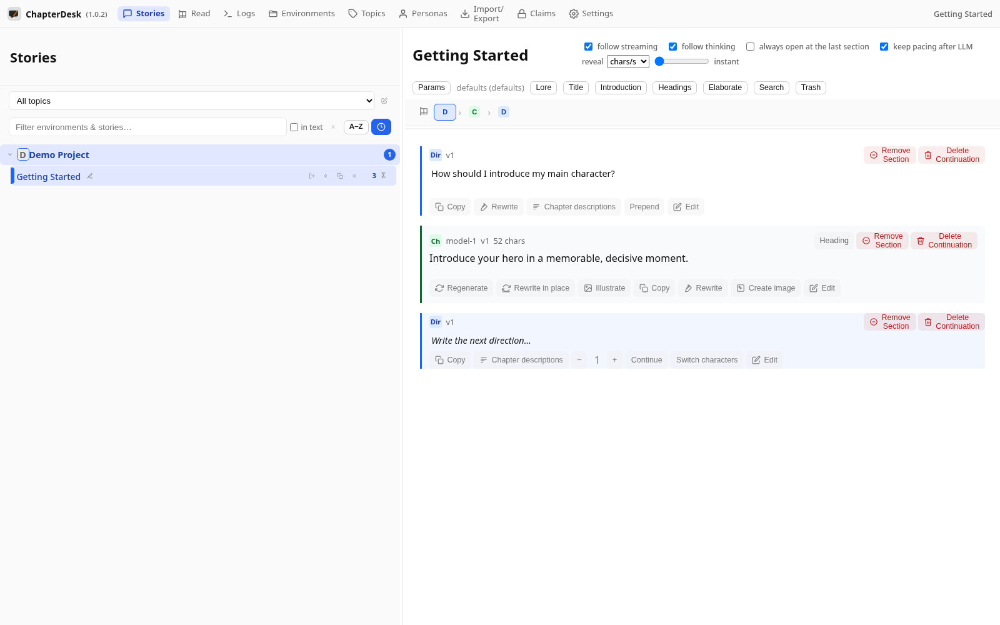

# Read your story as a book

> Auto-generated on 2026-10-26

## Step 01: Open a story

Open the seeded **Getting Started** story from the sidebar.

## Step 02: Open the Reader

Click the book button in the navigation bar (**Reader view**). The story is shown as a clean, read-only document.

## Step 03: Scroll the book

The Reader renders directions and chapters as book sections. The progress bar at the bottom tracks where you are.

## Step 04: Return to editing

Press **Escape** (or use the back navigation) to return to the editable tree.

