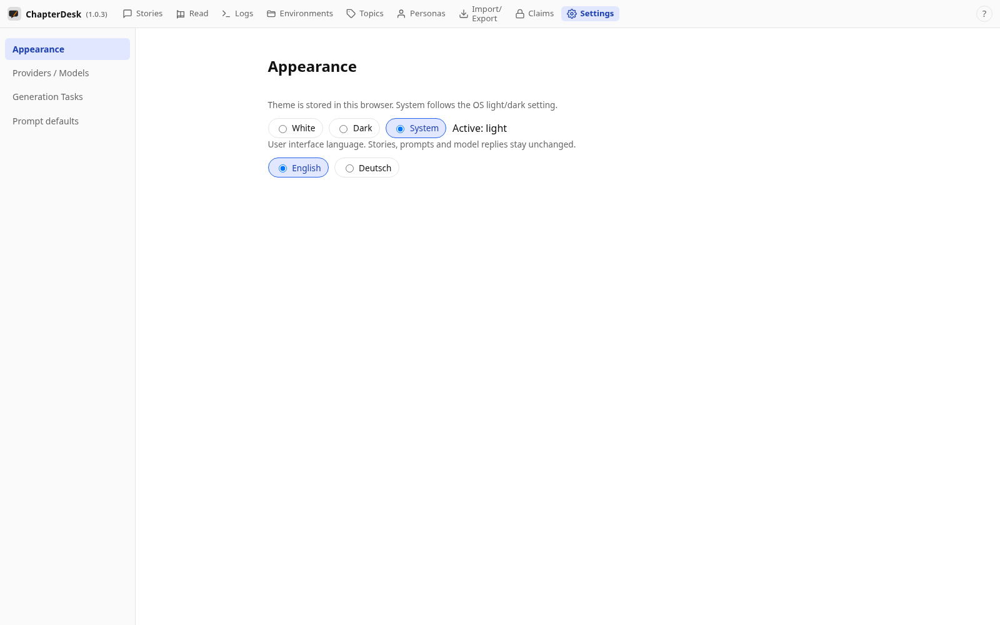
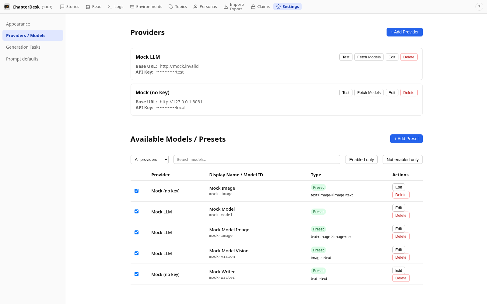
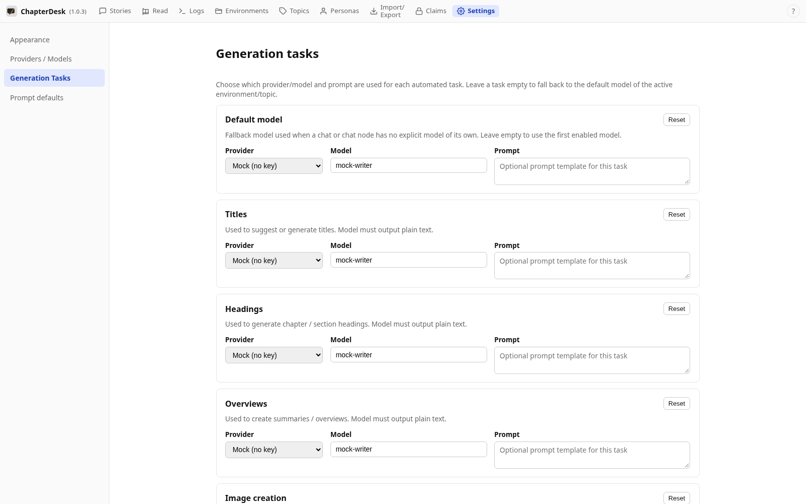
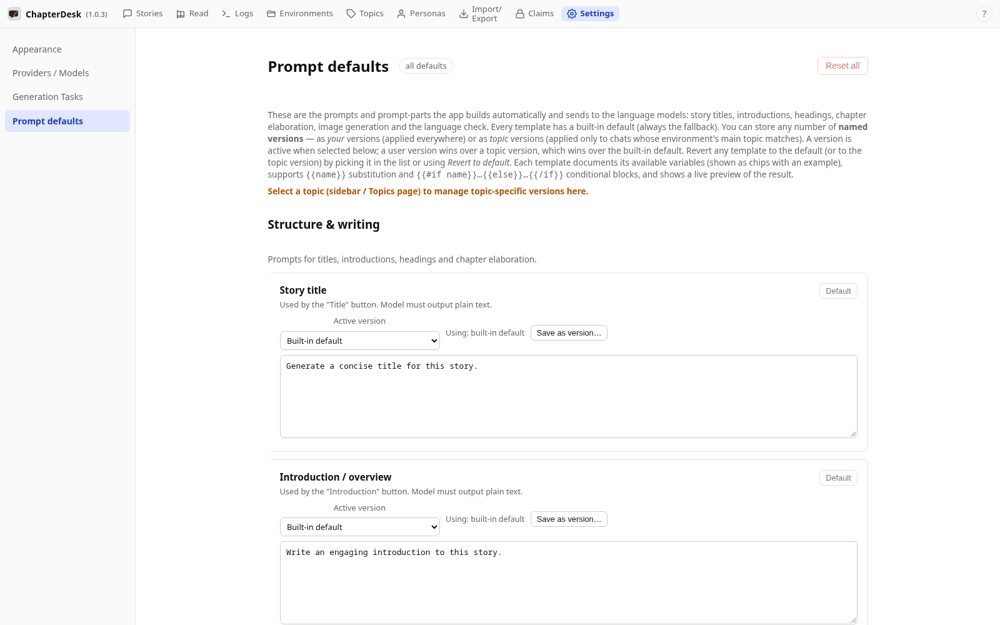

# Settings: Appearance, Providers, Tasks and Prompts

> Auto-generated on 2026-10-28

The **Settings** area groups the configuration pages: **Appearance**
(theme and language), **Providers / Models** (which AI providers and models
are enabled), **Generation Tasks** (which model handles each writing task) and
**Prompt defaults** (the built-in prompts ChapterDesk builds automatically).

This manual walks through each settings page.

## Step 01: Open the application

Launch ChapterDesk.

## Step 02: Open Settings

Use the **Settings** link in the top navigation. The **Appearance** page opens first — theme and language are stored per browser.

## Step 03: AI providers

The **Providers / Models** page manages AI providers and enables the models ChapterDesk may call.

## Step 04: Generation tasks

**Generation Tasks** picks which enabled model is used for each kind of writing task (title, headings, language check, images…).

## Step 05: Prompt defaults

**Prompt defaults** lets you read, edit or version the built-in prompts ChapterDesk builds automatically.

