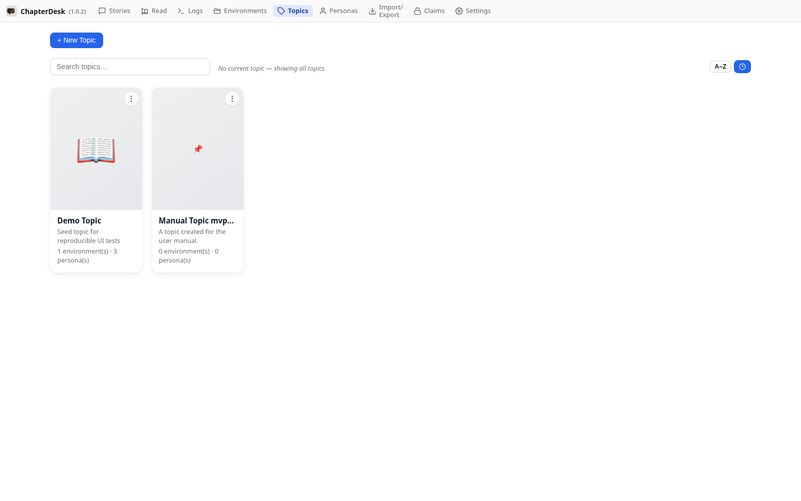
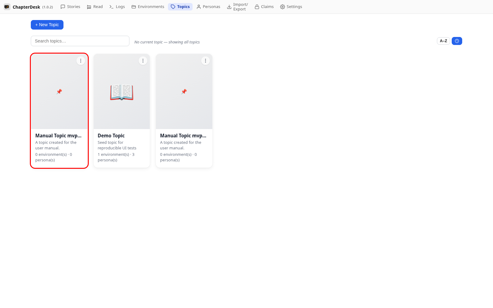
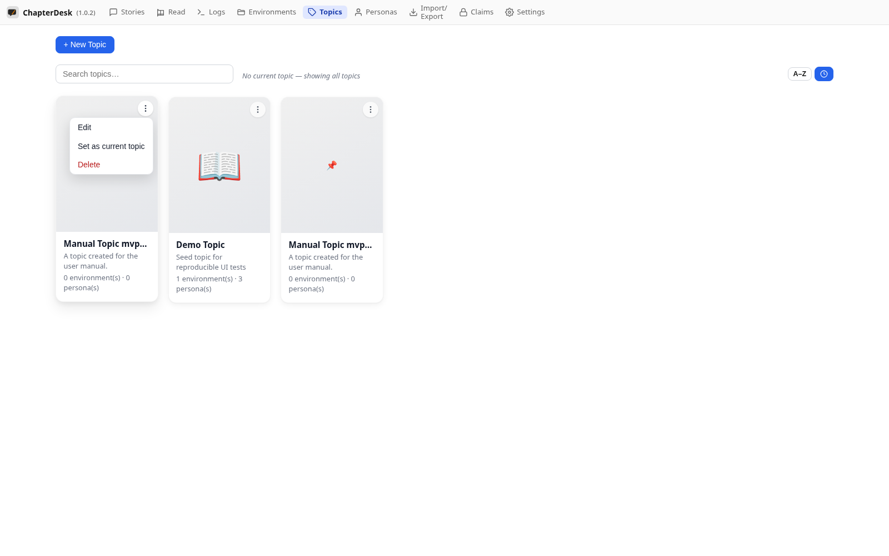

# Organize with topics

> Auto-generated on 2026-10-26

## Step 01: Open the Topics page

Use the **Topics** link in the top navigation. Topics group environments (books) and personas.

## Step 02: Create a topic

Click **+ New topic**, give it a name and description, then save.

## Step 03: Review the topic

The topic appears as a card with its description. Open its menu to edit, delete or mark it as the current topic.

