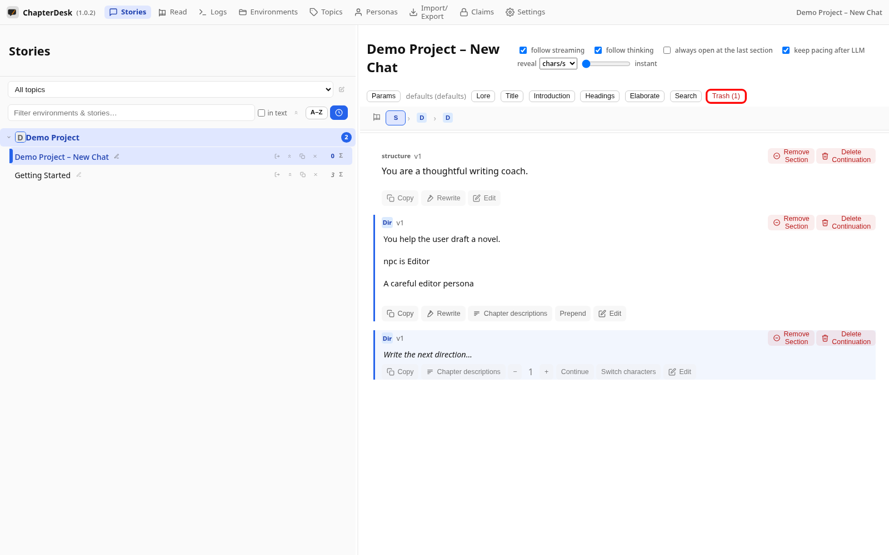
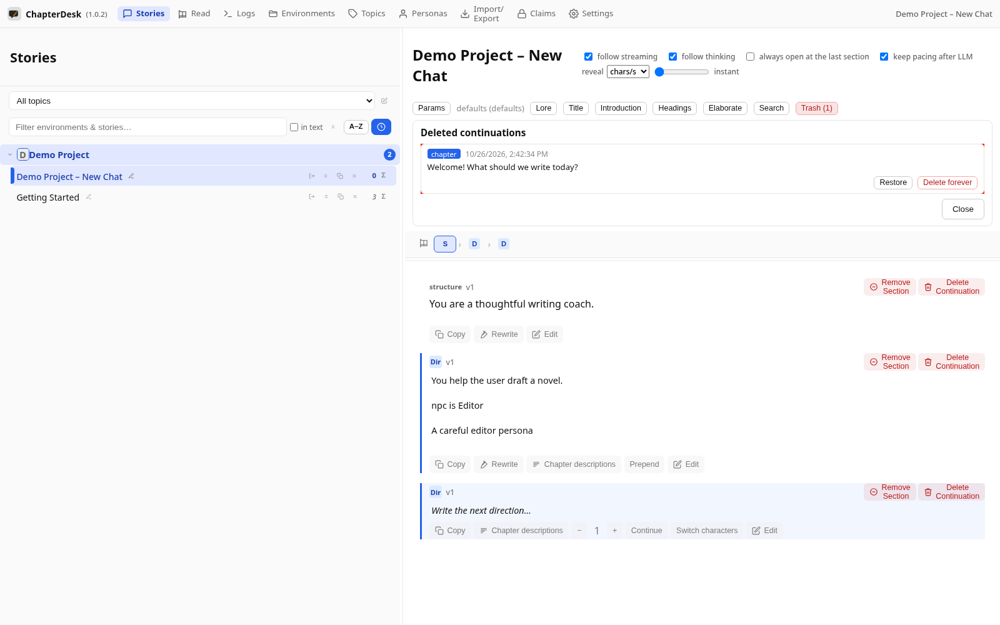
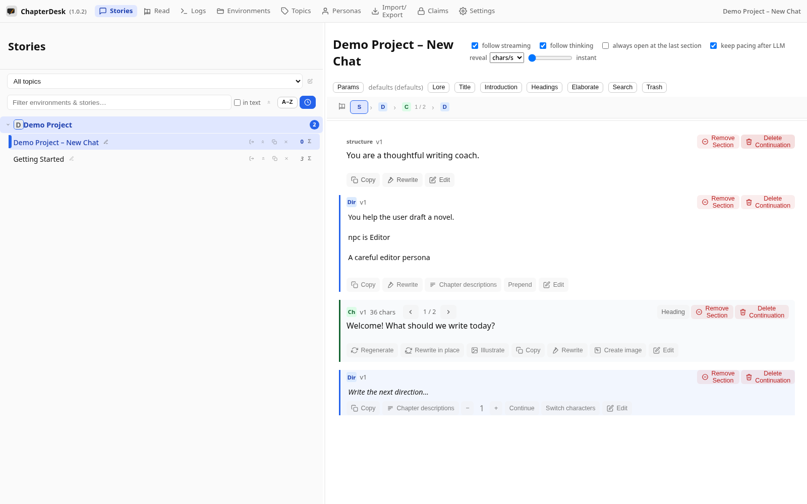
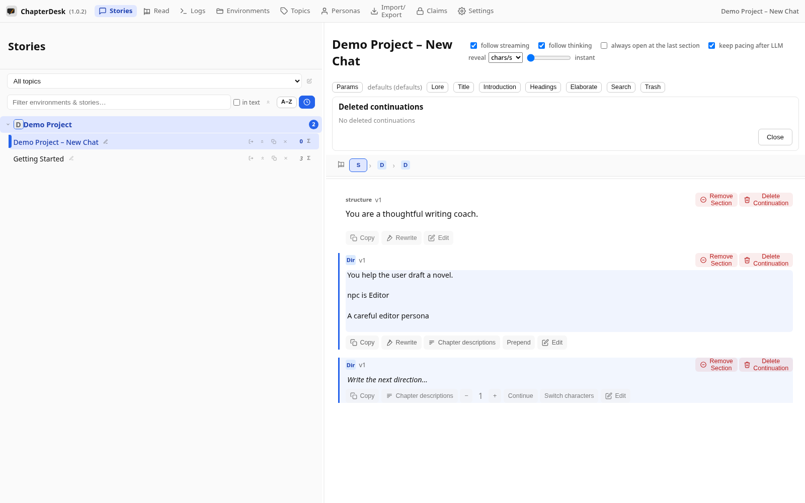

# Delete and Restore Sections

> Auto-generated on 2026-10-26

## Step 01: Open a fresh story

Start from a new story so there is a section to delete.

## Step 02: Delete a continuation

In the section header click **Delete Continuation** and confirm. The section is NOT destroyed — it moves to the **Trash**.

## Step 03: Open the Trash

Click **Trash (1)** in the toolbar. Each deleted continuation is listed with its role and a preview.

## Step 04: Restore the section

Click **Restore** — the continuation is placed back into the story and the Trash empties.

## Step 05: Purge forever

Delete the continuation again and choose **Delete forever** in the Trash. Purged sections cannot be recovered.

