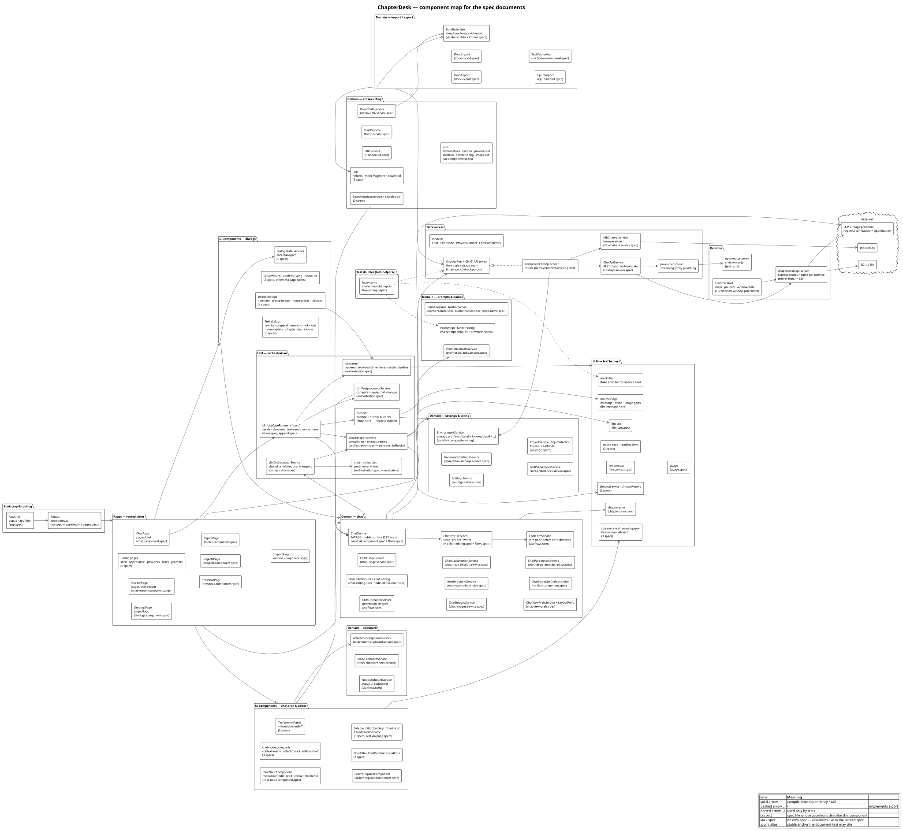

# Spec documentation — components, assignments, diagrams

This folder explains **what the unit specs of ChapterDesk actually pin down**.
It is written for two readers:

* someone who has to change a component and wants to know *which behaviour is
  guarded by a spec* before touching it, and
* someone who has to review a spec file and wants to know *which component and
  which flow it belongs to*.

Three documents, one diagram set:

| File | Generated? | What it is |
|---|---|---|
| [`component-map.puml`](component-map.puml) / `component-map.svg` | hand-written | the component map: every spec-owning component with its **alias** and the spec file that describes it |
| [`spec-inventory.md`](spec-inventory.md) | **yes** (`0scripts/spec-inventory.mjs`) | the **assignments**: every `describe` / `it` title of every spec file, grouped by component alias |
| [`assertions.md`](assertions.md) | hand-written | the **high-level explanations**: what a group of assertions guarantees, per component, cross-linked to the sequence diagrams |
| `flows/seq-*.puml` | hand-written | the **sequence diagrams** referenced by `assertions.md` (rendered next to each `.puml`) |

> Sibling document: [`../architecture/chat-ui.md`](../architecture/chat-ui.md)
> explains *why* the two big UI files are structured the way they are and
> which collaborators exist inside them — read it before redesigning anything
> that this folder's aliases (`PAGE_CHAT`, `CMP_NODE`, `CMP_NODE_ACTIONS`,
> `SVC_NAVMENU`) point at.

The three are meant to be read together: an assertion title from the inventory is
explained in `assertions.md`, and the explanation points into a sequence diagram,
whose participants are the aliases from `component-map.puml`.

---

## The component map



Every box is a component; the second line holds the source location, the third
line names the spec that describes it (`(x.spec)`) or says `via x.spec` when the
assertions live in another file. Packages are the layers:

```
Bootstrap & routing → Pages → UI components → Domain → LLM → Data access → Runtime
```

Arrows are dependencies (the direction the specs follow when looking for the next
component). The legend also marks the two dotted variants: `..|>` implements a
port, `..>` is used only by tests.

### Aliases

Aliases are the stable names used by the other documents and by the diagrams.
They only exist in the diagrams — nothing in the code is renamed.

| Alias | Component | Own spec |
|---|---|---|
| `APP` | `app.ts` + `app.html` shell | `app.spec.ts` |
| `ROUTES` | `app.routes.ts` | — (asserted through the page specs) |
| `PAGE_CHAT` | chat page (`pages/chat`) — the elaborate/batch dialog and the navbar context menus live here | `chat.component.spec.ts` |
| `PAGE_READER` | reader page | `chat-reader.component.spec.ts` |
| `PAGE_CONFIG` | config shell + appearance/providers/tasks/prompts | 5 specs |
| `PAGE_LOGS` | LLM log page | `llm-logs.component.spec.ts` |
| `PAGE_PERSONAS` / `PAGE_PROJECTS` / `PAGE_TOPICS` / `PAGE_IMPORT` | entity pages | one spec each |
| `CMP_NODE` | `ChatNodeComponent` — the bubble (edit, read, reveal, context menu) | `chat-node.component.spec.ts` |
| `CMP_NODE_PARTS` | pure helpers of the bubble (`context-menu`, `attachments`, `editor-scroll`) | 3 specs |
| `CMP_NODE_ACTIONS` | action layer of the bubble: `NodeActionState` (one action at a time), `EditorController` (draft + edit lifecycle), `SendController` (composer send / branch / insert / batches + streaming), `DialogActionsController` (prepend / compare / chapter descriptions) and `IllustrationController` (illustrate / re-render / prompt records) | 3 specs (send + illustration via `CMP_NODE`) |
| `CMP_VERSIONS` | version panel + version diff dialog | 2 specs |
| `CMP_EDITORS` | chat title / chat parameter editors | 2 specs |
| `CMP_SEARCH` | search & replace component | `search-replace.component.spec.ts` |
| `CMP_CHROME` | sidebar, shortcut help, toast host, app nav | 3 specs |
| `DLG_TEXT` | rewrite / prepend / resend / mark-note / name-replace / chapter-descriptions dialogs | 6 specs |
| `DLG_IMAGE` | illustrate / create-image / image picker / lightbox | 4 specs |
| `DLG_SYS` | setup wizard, confirm dialog | 2 specs |
| `SVC_DIALOGS` | dialog **state** services (`core/dialogs/*`) | 6 specs |
| `SVC_CHAT` | `ChatService` facade | — (via `chat.component.spec` + `flows.spec`) |
| `SVC_TREE` | chat-tree state/reader/writer | — (via `chat-editing.spec` + `flows.spec`) |
| `SVC_LORE` | `ChatLoreService` (lore node per direction) | — (via `flows.spec`) |
| `SVC_OP` | generation/operation lifecycle | — (via `chat-editing.spec`) |
| `SVC_EDIT` | `NodeEditSession` + chat editing ops | 2 specs |
| `SVC_USAGE` / `SVC_IMAGES` / `SVC_MARKS` / `SVC_NAVSEL` / `SVC_VIEWPREFS` | usage, images, reading marks, nav selection, view prefs | one spec each |
| `SVC_NAVMENU` | `ChatNavMenuService` — navbar context menus (paste insert/append, node menu) | `chat-nav-menu.service.spec.ts` |
| `SVC_ELABDLG` / `SVC_PARAMS` | elaborate dialog state, chat parameters | via page/editor specs |
| `CLIP_NODE` / `CLIP_STORY` / `CLIP_ATT` | node / story / attachment clipboard | 2 specs (node via `flows.spec`) |
| `SET_MAIN` / `SET_GEN` / `SET_SORT` / `SET_OTHER` / `SET_ENV` | settings, generation settings, sort prefs, projects/topics/theme, environment profile | 3 specs + page specs |
| `PR_DEFAULTS` / `PR_API` / `NAMES` | prompt defaults, prompt API + pricing, name replacement | 5 specs |
| `IO_DOCX_OUT` / `IO_DOCX_IN` / `IO_EPUB` / `IO_BUNDLE` / `IO_TEXTS` | docx/epub import + export, story bundles, text versions | 4 specs |
| `SEARCH_SVC` / `I18N` / `TOAST` / `DEMO` / `UTIL` / `UTIL_RUNTIME` | cross-cutting helpers | 8 specs |
| `ORCH_CORE` | `LlmOrchestratorService` + transport + postprocessor entry | `orchestration.spec.ts` |
| `ORCH_RUNNER` | `LlmFlowRunner` + `flows/*` | `flows.spec.ts` (53) + `append.spec.ts` |
| `ORCH_USECASES` / `ORCH_CONTEXT` / `ORCH_TRANSPORT` / `ORCH_POST` / `ORCH_PURE` | use cases, context/prompt builders, transport, postprocessing, slots+evaluators | via `orchestration.spec` + `flows.spec` |
| `LEAF_MSG` / `LEAF_SSE` / `LEAF_CTX` / `LEAF_REVEAL` / `LEAF_PACE` / `LEAF_PLAN` / `LEAF_USAGE` / `LEAF_LOG` | leaf helpers of the LLM layer | 10 specs |
| `PORT` | `ChatApiPort` — the single storage seam | — (contract pinned by its implementations) |
| `COMPOSITE` | `CompositeChatApiService` (profile routing) | — (behaviour covered by `IDB` + `HTTP` specs + `EnvironmentService`) |
| `IDB` / `HTTP` | IndexedDB store / stateless REST client | 2 specs |
| `SERVER` | Express API + sqlite persistence | 10 jest specs |
| `PROXY` | chat-server-js / openrouter-proxy | 2 jest specs |
| `HELPERS` | `test-helpers/` — in-memory API + factories | used by the specs, not spec'd itself |

Components *without* an own spec are always covered **through** a spec of their
caller; `assertions.md` says which one and why.

---

## The sequence diagrams

| Diagram | Illustrates | Main specs |
|---|---|---|
| [`flows/seq-send-branch.puml`](flows/seq-send-branch.puml) | one sending flow end to end: question node → lore → messages → stream → versioned answer | `flows.spec.ts` |
| [`flows/seq-elaborate-held.puml`](flows/seq-elaborate-held.puml) | the elaborate chain with a prefetched ("held") chapter, finalize, drain and discard | `flows.spec.ts`, `chat.component.spec.ts` |
| [`flows/seq-lore-once.puml`](flows/seq-lore-once.puml) | chat lore: one node per direction, sent once, then excluded; re-arm on regenerate/rewrite | `flows.spec.ts` |
| [`flows/seq-structure-headings.puml`](flows/seq-structure-headings.puml) | heading generation for every unheaded chapter on the active path | `flows.spec.ts`, `chat.component.spec.ts` |
| [`flows/seq-version-edit.puml`](flows/seq-version-edit.puml) | editing a chapter: edit session, versioned write, dirty confirm, diff panel | `node-edit-session.spec.ts`, `chat-editing.spec.ts`, `idb-chat-api.service.spec.ts` |
| [`flows/seq-illustrate.puml`](flows/seq-illustrate.puml) | the Illustrate action layer: guards (`NodeActionState`), dialog → use case → placement plan → versioned chapter, and the adapt-and-re-render path | `chat-node.component.spec.ts`, `node-action-state.spec.ts`, `orchestration.spec.ts` |
| [`flows/seq-storage-routing.puml`](flows/seq-storage-routing.puml) | where a write lands: storage profile → IndexedDB or server | `idb-chat-api.service.spec.ts`, `chat-api.service.spec.ts`, server specs |
| [`../stream-reveal.puml`](../stream-reveal.puml) | (pre-existing) how a streamed answer appears character by character | `stream-reveal.spec.ts`, `reveal-queue.spec.ts` |

---

## Regenerating

The diagrams are rendered through the **local PlantUML server** (default
`http://localhost:9999`) so no local jar/Java is needed:

```bash
node 0scripts/render-puml.mjs docs/specs          # all *.puml below the folder
node 0scripts/render-puml.mjs docs/specs/flows    # only the flow diagrams
PLANTUML_SERVER=http://other-host:8080 node 0scripts/render-puml.mjs docs/specs
```

The `.svg` files next to the `.puml` files are the ones the docs site shows; they
are committed. If the server is not running, `plantuml -tsvg <file>` works too.

The inventory is regenerated from the spec sources:

```bash
node 0scripts/spec-inventory.mjs           # writes spec-inventory.md
node 0scripts/spec-inventory.mjs --stdout  # print instead (diff before writing)
```

Both generators are plain Node scripts with no dependencies, so they also work in
CI.

### What the inventory generator does (and does not do)

* It reads `describe(` / `it(` / `test(` first arguments and their brace depth —
  it does **not** execute the specs.
* Template-literal or computed titles appear as `<dynamic>`.
* The component alias comes from the prefix table at the top of
  `0scripts/spec-inventory.mjs`; a missing alias shows up as `—` in the table and
  an alias that no longer exists in `component-map.puml` is flagged with `⚠`.
  Add a prefix there (longest-first) when you add a spec in a new folder.
