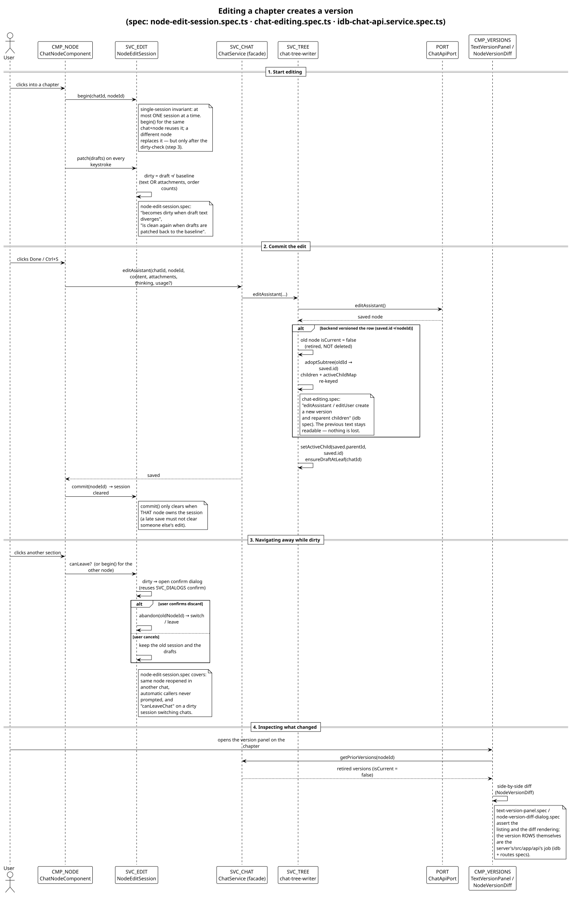
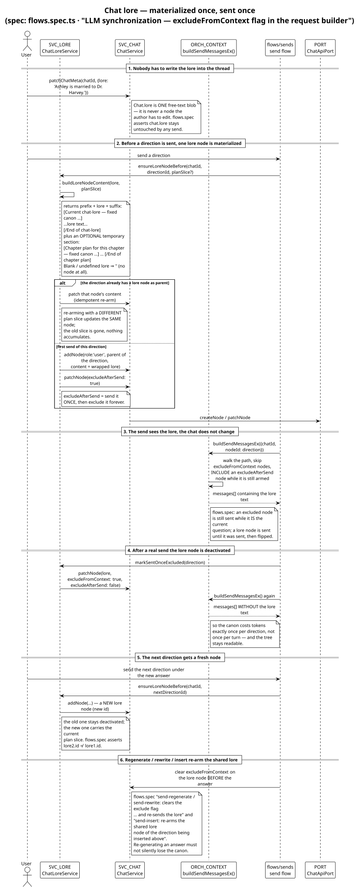
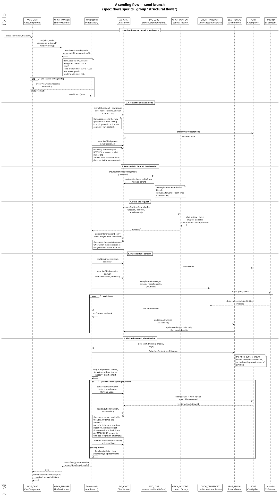
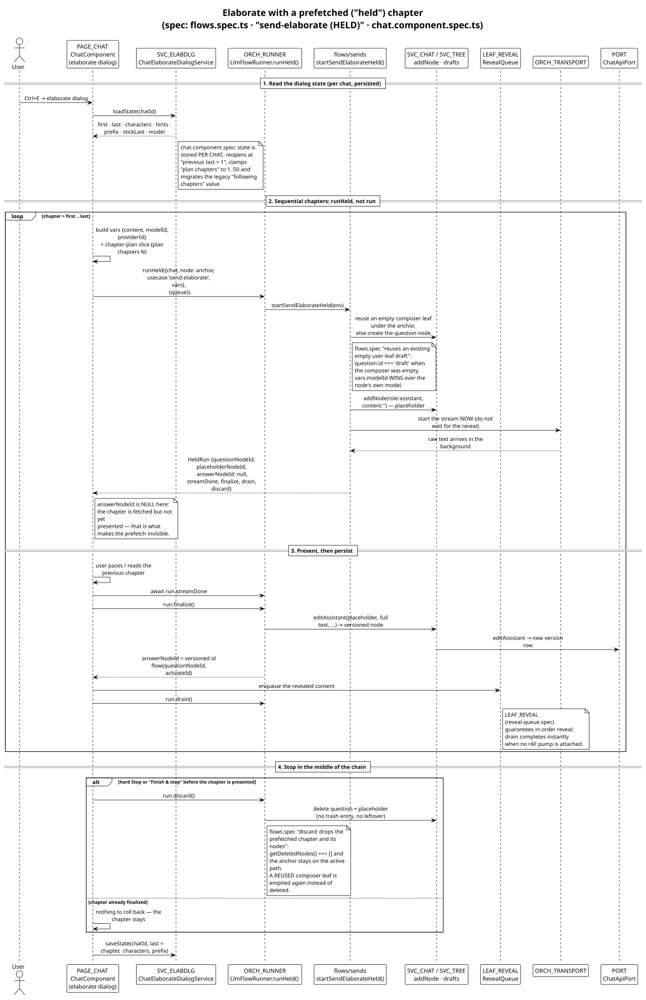
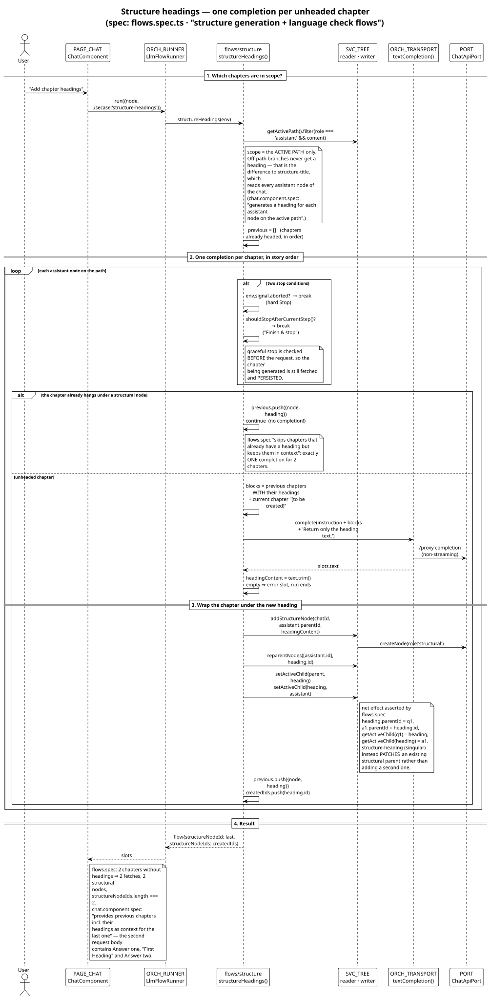
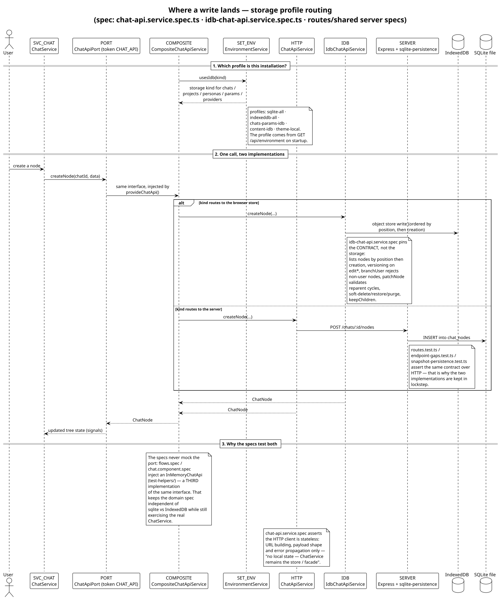

# What the specs assert

This is the explanatory companion to [`spec-inventory.md`](spec-inventory.md)
(the raw assignment titles) and to [`component-map.puml`](component-map.puml)
(the components). For every component cluster it answers three questions:

1. **What is guaranteed?** — the behaviour the assertions pin down, in one or
   two sentences per bullet.
2. **Which assignments?** — the `describe` group of the spec file, so the exact
   `it` titles can be looked up in the inventory.
3. **Where is the flow?** — the sequence diagram that shows the same thing as a
   message trace.

Two conventions used throughout:

* `flows.spec.ts · "structural flows"` means: file
  `src/app/core/llm/orchestration/flows.spec.ts`, group
  *LLM orchestration — structural flows (branch / insert / regenerate / rewrite /
  prepend)*.
* Component names in `code font` refer to aliases of the component map.

---

## 1. Presentation

### 1.1 `PAGE_CHAT` — the chat page

`chat.component.spec.ts` (89 cases, one big `Chat` group plus
`Chat · elaborate with real streaming`). It is the specification of the
*interaction*, not of the tree: it renders the real `ChatService` on top of the
in-memory API and drives the page through its public handlers.

Guarantees worth knowing before touching the page:

* **Navigation and selection.** The navbar shows the active path, marks the node
  being edited with a dot, keeps excluded nodes visible while they still have
  siblings (so branches stay reachable), and never selects the empty terminal
  draft. `Ctrl+click` toggles one node, `Ctrl+drag` selects a range in navbar
  order, and a copied selection becomes an ordered sequence.
* **Search scope.** "Node" search reads the **live draft** of a node that is
  being edited and the committed content of every other node, then scrolls both
  the textarea and the tree to the hit.
* **Elaborate dialog.** First/last chapter, characters, hints, prefix, model and
  "plan chapters" are per-chat state: the dialog reopens at *previous last + 1*
  with the last characters, `stick-to-last` re-points first/last at the stored
  last chapter, the plan count is clamped to 1..50 (rendered as a *total per
  send*, default 2) and the legacy "following chapters" value is migrated
  (N following → N+1 total). The dialog's preview is a computed signal, so the
  generic and per-character templates are derived, not duplicated.
* **Batch behaviour.** Chapters are elaborated first..last **sequentially**, each
  one on the currently *visible* tree (not on the most recent branch), with the
  plan slice for that chapter added to the lore of that send only. Progress is
  reported as current → destination chapter. The model chosen in the dialog wins
  for every chapter of the run.
* **Anchoring is asserted explicitly** ("anchors elaborate on the currently
  visible tree, not the most recent branch") — this is the regression guard for
  the class of bug where a batch starts on a stale branch.
* **Structure generation from the page.** Title, introduction and headings are
  triggered from here; the page-level assertions cover the *wiring*
  (all assistant nodes as context, introduction placed first or right after an
  existing structure node, headings for each active-path chapter) while the
  mutation itself is asserted in `flows.spec.ts` (§3.1).
* **Reading aids.** Marks (`Ctrl+M`), paced reading (`Ctrl+R`, `P`), the reader
  hand-off, and "Finish & stop" (graceful stop button, only while generating).

### 1.2 `CMP_NODE` — the bubble, and its pure helpers

`chat-node.component.spec.ts` is the largest file (200 cases). It asserts the
node's own behaviour: edit/read mode, the context menu built per role and state,
attachment intake (`filesToAttachments` rejects oversize payloads), the reveal
of streamed text, follow-scrolling, and the click-to-edit caret mapping.

The extracted pure parts have their own specs, which is where the exact
contracts live:

* `CMP_NODE_PARTS` — `buildCtxMenuItems(ctx)` (which items a role/state shows),
  `filesToAttachments`, `sourceOffsetAtPoint`, `findTextRange` (locating a stored
  reading mark in the **rendered** text), `selectRangeAndScroll`.
* `CMP_VERSIONS` — `TextVersionPanelComponent` lists a chapter's versions and
  `NodeVersionDiffDialogComponent` renders the Monaco diff.
* `CMP_EDITORS` / `CMP_SEARCH` / `CMP_CHROME` — title & parameter editors,
  search/replace UI, sidebar, shortcut help, toast host.

### 1.3 Dialogs

`DLG_TEXT` (rewrite, prepend, resend, mark-note, name-replace, chapter
descriptions), `DLG_IMAGE` (illustrate, create-image, image picker, lightbox) and
`DLG_SYS` (setup wizard, confirm) are asserted as *form + emit* components: the
specs check that the dialog renders derived values, validates inputs, and emits
exactly one intent per confirm — never that it writes to the API.

The dialog **state** lives in `SVC_DIALOGS` (`core/dialogs/*`), and that is where
the interesting assertions are: `IllustrateDialogService` (19 cases) and
`CreateImageDialogService` (6) assert model/format selection persistence,
`createModalState` asserts the shared open/close mini-state machine, and
`SetupWizardService` asserts the first-run step sequence.

---

## 2. Domain — chat

### 2.1 `SVC_EDIT` — edit sessions and structural edits

Two files, both load-bearing for the tree.

`node-edit-session.spec.ts` (29 cases) asserts the **single-session invariant**
and the dirty-tracking that protects unsaved text:

* exactly one session at a time; `begin()` on the same chat+node reuses it, a
  different node replaces it, and `patch()` from a node that does not own the
  session is ignored;
* dirty means *draft ≠ baseline*, where attachments count and **attachment order
  counts** — patching the drafts back to the baseline makes it clean again;
* switching node or chat while dirty opens the confirm dialog and keeps the old
  session until the user answers; automatic callers are never prompted;
* `commit(nodeId)` / `abandon(nodeId)` only clear when that node owns the session
  (a late save must not clear somebody else's edit).

`chat-editing.spec.ts` (39 cases) asserts the tree edits as operations:

* **delete cascade** removes the node and every descendant (leaf, mid-tree, whole
  tree), **delete keepChildren** reparents the children (or promotes them to
  roots);
* **insert** above a mid-tree question hangs the old subtree under the new answer
  and adopts *every* previous sibling, not just the edited one;
* `reparentNodes` skips self-parenting, can lift a node to root, and validates
  cycles;
* `ensureDraftAtLeaf` / `ensureDraftUnderAnswer` create **at most one** composer
  leaf, reuse an existing empty draft or a typed-but-unsent leaf, never hang one
  under a streaming or non-assistant node, and an in-flight call is shared
  instead of duplicated (the "batch stopping after lore sends" regression);
* **trash** lists only the branch root, restores it, purges it;
* **graceful stop** (`Finish & stop`) does not abort the running stream, is
  cleared when an operation begins or ends, does not leak into a later plain
  send, and a chat-scoped stop keeps *that* chat cancelled until its run ends.

### 2.2 Versions — how an edit reaches the thread

The split of responsibility is deliberate: `SVC_EDIT`/`SVC_TREE` decide *what* the
new state is (retire the old row, adopt the subtree, re-key the active-child
map), `PORT` decides *where* it is stored, and `IDB`/`SERVER` decide *how* a
version row is created. `edited → versioned node` is therefore asserted twice:
once against the in-memory API (`chat-editing.spec`, `flows.spec`) and once
against the real store (`idb-chat-api.service.spec`: *"editAssistant / editUser
create a new version and reparent children"*).

### 2.3 `SVC_TREE` / `SVC_CHAT` — the facade and the tree

Neither has an own spec, on purpose: `ChatService` is a facade that re-exports
the tree services, and the tree services are written by `SVC_EDIT`/`flows.spec`
and read by `chat.component.spec`. What *is* asserted separately are the small
services that own a policy:

* `SVC_USAGE` — per-node usage is summed into the chat totals and backfilled from
  the browser log.
* `SVC_MARKS` — reading marks survive reloads and carry their notice.
* `SVC_NAVSEL` — toggle/range/drag state of the navbar selection, fed with the
  active path and an `isTerminal` predicate.
* `SVC_VIEWPREFS` — `streamRevealPrefs` is gated: follow-streaming off means no
  pacing.
* `SVC_IMAGES` — attachment helpers.

### 2.4 `SVC_LORE` — the canon that is sent once

`flows.spec.ts · "LLM synchronization — excludeFromContext flag in the request
builder"` is the lore specification. The assertions that matter:

* `buildLoreNodeContent` wraps raw lore with a prefix **and** a suffix, returns
  `''` for blank input, and appends an optional temporary
  `[Chapter plan for this chapter …]` section (a plan-only node is valid; a
  blank plan is ignored).
* `ensureLoreNodeBefore` inserts exactly **one** lore node in front of the
  direction, arms it `excludeAfterSend`, and leaves `Chat.lore` untouched — the
  canon never leaks into the author's permanent text.
* Re-arming with a different plan slice patches the *same* node (idempotent), and
  the previous slice is gone.
* After a real send the node is flipped to `excludeFromContext` and stops being
  shipped; the next direction gets a **new** lore node (different id).
* `send-regenerate`, `send-rewrite` and `send-insert` clear the exclude flag
  before the answer, so regenerating does not silently lose the canon.

---

## 3. LLM layer

### 3.1 `ORCH_RUNNER` — the flows

`flows.spec.ts` (51 cases) drives the real `ChatService` with a stubbed `fetch`,
so every assertion is about the **end state of the tree + the request that was
sent**:

* `send-branch` creates a *real sibling* question (branching a question → sibling
  under its parent; branching an answer → child question), switches the active
  path before streaming, streams the answer into a placeholder, and finalizes it
  into a **versioned** assistant node. The assertions name the ids explicitly:
  `flow.answerNodeId` is the versioned id, `answer.parentId` is the new question,
  `getActiveChild(...)` points at the branch.
* **Image-only answers are content.** A model that returns pictures and no text
  still finalizes the chapter: the content becomes the direction text and the
  image is attached as `illustration-1.*`. This is asserted for streamed SSE
  *and* for non-streaming JSON answers — the failure mode (empty bubble marked
  "Generation stopped", picture lost) is exactly what the tests forbid.
  `flow.empty` stays `false`.
* `send-insert` adopts the previous siblings under the new answer;
  `send-regenerate` deletes the answer (+ subtree) and re-streams under the same
  question; `send-rewrite` deletes only the answer, keeps the following text and
  **preserves the old attachments while merging the new image**; `send-prepend`
  inserts a director node before the direction and adopts it.
* `send-chapter-descriptions` branches a sibling question and streams the list
  with the previous chat content as history.
* `send-elaborate` appends answer under fresh question under the anchor; the
  dialog-chosen model wins (`vars.modelId`), including on the versioned answer;
  an existing empty user leaf is **reused** as the question instead of creating a
  sibling.
* **Request builder** (`buildSendMessagesEx`): an `excludeFromContext` node is
  skipped but the current question is still sent; a history override replaces a
  clamped previous answer with its **full** text; a text attachment on the
  current question is inlined; an `excludeAfterSend` node is included until it
  was sent and flipped afterwards.

### 3.2 `ORCH_RUNNER` — elaborate with a prefetched chapter

The `HELD` assertions are the reason a batch feels seamless. `runHeld` returns
after the question and placeholder exist, with `answerNodeId === null`; the stream
finishes in the background (`streamDone`), and the caller decides:

* `finalize()` persists the full text as a versioned answer and reports
  `flow.activateId` — this is the moment the chapter becomes part of the story;
* `drain()` completes the reveal (instant when no animation frame pump is
  attached);
* `discard()` rolls a prefetched chapter back **completely**: no question, no
  placeholder, nothing in the trash (`getDeletedNodes() === []`), and the anchor
  stays on the active path. If an empty composer leaf was reused, it is emptied
  again (`content === ''`, still under the anchor) instead of being deleted.

### 3.3 `ORCH_RUNNER` — structure generation

* `structure-title` wraps the whole story under a root structural node and sets
  the chat title.
* `structure-overview` places the introduction right after an existing structure
  node, or becomes the first node when none exists (then the old root is adopted
  under it and the active path starts with the introduction).
* `structure-heading` uses **only the chapter's own text** (the assertion checks
  the request does *not* contain the preceding question), and either wraps the
  chapter under a new heading or **patches** the existing structural parent
  instead of adding a second one.
* `structure-headings` heads every unheaded chapter on the active path, one
  completion per chapter, with earlier chapters **and their generated headings**
  in the context of the next request; chapters that already have a heading are
  skipped but still appear in the context.
* `language-check` returns the three corrected variants and mutates nothing.

### 3.4 `ORCH_CORE` — transport, evaluators, use cases

`orchestration.spec.ts` (53 cases) covers what must not depend on the UI:

* **evaluators are pure and never throw** — a response or an error becomes a
  named slot (`text`, `images`, `usage`, `error`) or nothing;
* the **dispatch** is a plain if-chain, so a new use case cannot silently fall
  through;
* **transport fallbacks** live in the transport: retries, the images endpoint
  fallback tree for image-capable models, long-running requests, streaming fold;
* the orchestrator **does not throw** — errors end up as slots, which is what
  lets a flow decide to finalize or roll back;
* the planned-scenes pipeline, `image-generation` (one explicit picture) and
  `image-send` (text + optional reference images) are asserted as use cases.

### 3.5 `LEAF_*` — the leaves the flows stand on

| Alias | Guarantees the assertions pin down |
|---|---|
| `LEAF_MSG` | `inferMimeType`, data-URL decoding, and `nodeToMessageContent` per attachment kind: no attachment, images (as image parts), textual files (inlined), **recorded image prompts excluded** from story context, binary files (pdf ⇒ not inlined), mixed bags. Plus `normalizeChatMessages`, `extractLlmImages`, `extractLlmRefusal`, `imagePartToAttachment`/`estimateDataUrlBytes`, director prepend helpers. |
| `LEAF_SSE` | SSE framing: `dataPayload`, `asText`/`extractLlmDelta`, happy path, and the **edge cases that drop letters** (multi-line `data:`, split chunks, `[DONE]`). |
| `LEAF_CTX` | seed-node drafts for topics, for the sidebar's current topic, and for an environment prompt + greeting. |
| `LEAF_REVEAL` | `StreamReveal` in char and word mode, `finish`/`pace-after-complete`/abort/flush/destroy, `hold`/`activate`/`rebase` for background continuation; `RevealQueue` (decoupled presenter, background buffers); `HeldAnswerStream`. See also [`../stream-reveal.puml`](../stream-reveal.puml). |
| `LEAF_PACE` | `PacedReadService` reveals existing text at the reading pace without an LLM call; `reading-time` estimates the duration at the reveal speed. |
| `LEAF_PLAN` | chapter-plan: the **strict** parser (the format contract the model must satisfy), the tolerant parser, the slice used for one send, and the record attachment that marks a chapter plan as already interpreted. |
| `LEAF_USAGE` | `parseProviderUsage` normalizes provider-specific usage, `addUsage`/`sumUsage` aggregate it. |
| `LEAF_LOG` | the LLM log records every call and survives reloads; resend re-issues a logged request. |

---

## 4. Data access and backend

`PORT` (`ChatApiPort`) is the seam. Its contract is asserted **twice**, from both
ends, because the two implementations must behave identically:

* `IDB` — `idb-chat-api.service.spec.ts` (22 cases) asserts the whole contract
  against IndexedDB: projects (incl. `deleteProject` with and without
  `deleteChats`), chats (newest-first listing, title *and* node-content search,
  `patchChat` for title/project/lore/`autoExcludeDirections`, `cloneChat` with
  remapped ids, 404s), nodes (ordering by position then creation,
  `reorderSiblings`, versioning on `edit*`, `branchUser` rejecting non-user
  nodes, cycle-validating `patchNode`, soft delete/restore/purge, `keepChildren`),
  personas/topics/providers/models/parameters, paged usage.
* `HTTP` — `chat-api.service.spec.ts` (11 cases) asserts the client is
  **stateless**: URL building, payload shape, error propagation only. "No local
  state — `ChatService` remains the store / facade".
* `SERVER` — 10 jest specs against Express + SQLite assert the same endpoints
  (`routes`, `endpoint-gaps`, `snapshot-persistence`), the error-handling
  middleware (4-arg handler, `headersSent` guard), the key-free mock LLM
  provider, proxy auth adaptation/streaming/long-running requests, and text
  versions (automatic recording, GET validation, restore, delete, cleanup on
  entity deletion).

`COMPOSITE` (profile routing) and `SET_ENV` (which profile this install is) have
no own spec — their behaviour is implied by the two implementations plus the
profile list in `EnvironmentService`.

---

## 5. Cross-cutting

* `IO_DOCX_OUT` — docx export is asserted in layers: document selection and
  `classifyStructure`, `buildDocxBlob`, `imageDimensions`/`imageSizeEmu` (the EMU
  math and the fallback when an image cannot be measured), and `buildMarkdown`.
* `IO_DOCX_IN` / `IO_EPUB` — import parses a document into chat nodes.
* `SEARCH_SVC` — `buildSearchRegExp`/`isValidRegex`, `findAll`, `expandReplace`,
  `replaceOneMatch`, `replaceAllInText`, `highlightMatchesIn`, plus the service's
  session handling.
* `NAMES` — the pure name-replacement engine (71 cases, incl. gender
  identification for capital-letter names) and the zxcvbn seed list.
* `I18N`, `TOAST`, `DEMO` (demo data builds a story through the real services),
  `UTIL` (`download` helpers, `newId`, `markFragmentInSource` — marker-map based,
  never a text search of the raw source, and `squash`).

---

## 6. What is *not* asserted, and where that is covered instead

| Component | Why there is no own spec | Covered by |
|---|---|---|
| `ROUTES` | it is data, not behaviour | the page specs + `e2e/tests` |
| `SVC_CHAT` (facade) | pure delegation | `chat.component.spec`, `flows.spec` |
| `SVC_TREE` | exercised through the services that own the operations | `chat-editing.spec`, `flows.spec` |
| `SVC_LORE`, `SVC_OP` | policies that only make sense inside a send | `flows.spec` |
| `COMPOSITE`, `SET_ENV` | routing table | the two implementation specs |
| `MODELS` | types only | — |
| `ORCH_TRANSPORT`, `ORCH_POST`, `ORCH_CONTEXT`, `ORCH_PURE`, `ORCH_USECASES` | sub-parts of `ORCH_CORE`/`ORCH_RUNNER` | `orchestration.spec`, `flows.spec` |
| `MOCK` (`core/mock-llm`) | test infrastructure | used by the server specs |
| `ELECTRON`, `PXMUX`, `PROXY` | outside the Angular test runner | server jest specs, `e2e/`, `e2e/manual` |
| `UTIL_RUNTIME` (`dom-metrics`, `version`, `provider-url`, `electron`) | measured in the component specs that use them | `CMP_NODE`, `chat.component.spec` |

Browser-level behaviour lives in `e2e/tests` (Playwright) and in the generated
manual under `docs/manuals/`; it is intentionally **not** part of this inventory.

---

## 7. Patterns the specs share (useful when adding one)

* **No mocked port.** Domain specs inject `InMemoryChatApi` behind
  `{ provide: CHAT_API, useValue: api }` and stub `fetch` for the LLM. The real
  `ChatService`, the real flows and the real tree logic run; only the two edges
  (storage, network) are replaced. That is why a `flows.spec` assertion can talk
  about node ids and active-child pointers.
* **Stubbed network, real protocol.** SSE answers are built as real `Response`
  objects (`sseResponse`, `sseImagesResponse`, `jsonImagesResponse`), so the
  parser and the reveal pump are exercised too.
* **Assert the request, not the intent.** Where the prompt matters, the spec
  parses the `fetch` body and asserts on the messages (`toContain('Chapter
  text')`, `not.toContain('Question')`, earlier chapters + headings present).
* **Assert the absence.** Rolling back (`discard`) and exclusion (lore) are
  asserted as *nothing left behind*: no node, no trash entry, no lore text in the
  next request.
* **Deterministic time.** Pacing/reveal specs run without `requestAnimationFrame`
  so `drain()` completes instantly; time-dependent assertions use the reveal
  queue's own knobs instead of sleeps.
