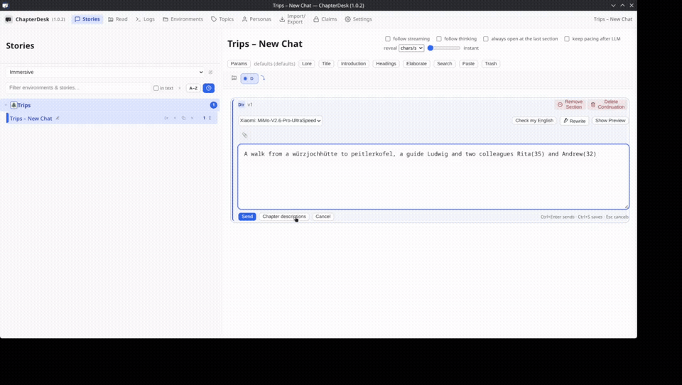
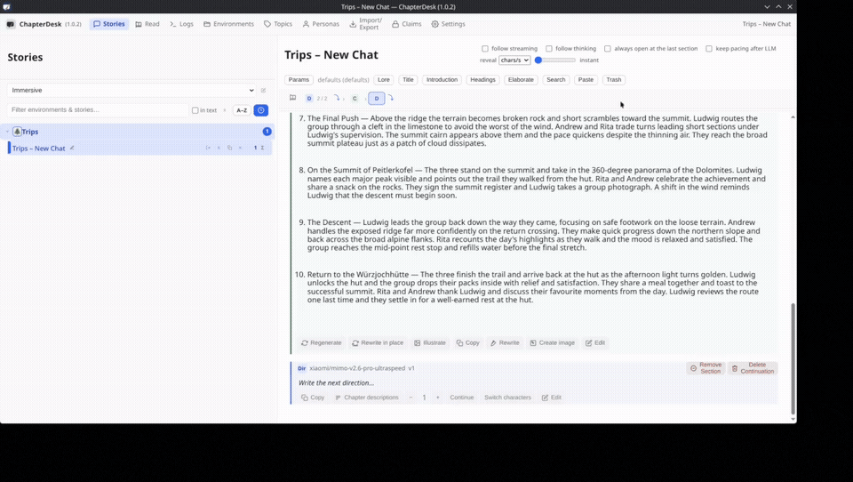

# Chapter Headings and Elaboration

How to turn a short theme into a chapter outline, then expand selected chapters into full prose from character points of view.

## 1. Generate chapter headings

| Time | Caption |
|------|---------|
| 0:00–0:03 | Open “Create chapter descriptions” |
| 0:03–0:05 | Set number of chapters and sentences per description |
| 0:05–0:08 | Describe what the chapters should achieve |
| 0:08–0:10 | Generate the numbered list of headings and descriptions |
| 0:10–0:15 | Review the outline (here: a hike from Würzjochhütte to Peitlerkofel) |

The model produces a structured list of chapter headings and short descriptions based on your theme. You can edit the result before elaborating.

## 2. Elaborate chapters from character points of view

| Time | Caption |
|------|---------|
| 0:00–0:03 | Open “Elaborate chapters” and choose the range (e.g. 1–2) |
| 0:03–0:06 | Add characters (Ludwig, Rita) |
| 0:06–0:09 | Generate Chapter 1 from Ludwig’s point of view |
| 0:09–0:12 | Chapter 2 written from Rita’s perspective |
| 0:12–0:15 | Elaborate Chapter 3 from Andrew’s view |

Each chapter is expanded using only the material that belongs to that chapter. You can specify which characters’ viewpoints to use and later continue, rewrite, or switch perspectives.

---

### Tips

- Start with a clear short theme when generating headings.
- You can elaborate one chapter or a range at a time.
- The model is instructed not to pull events from later chapters into earlier ones.
- After elaboration you can still edit, regenerate, or continue writing manually.

**Related**

- [Provider & Model Setup](./provider-model-setup.md)
- [Write Your First Chapter](../manuals/manual-new-story.md)