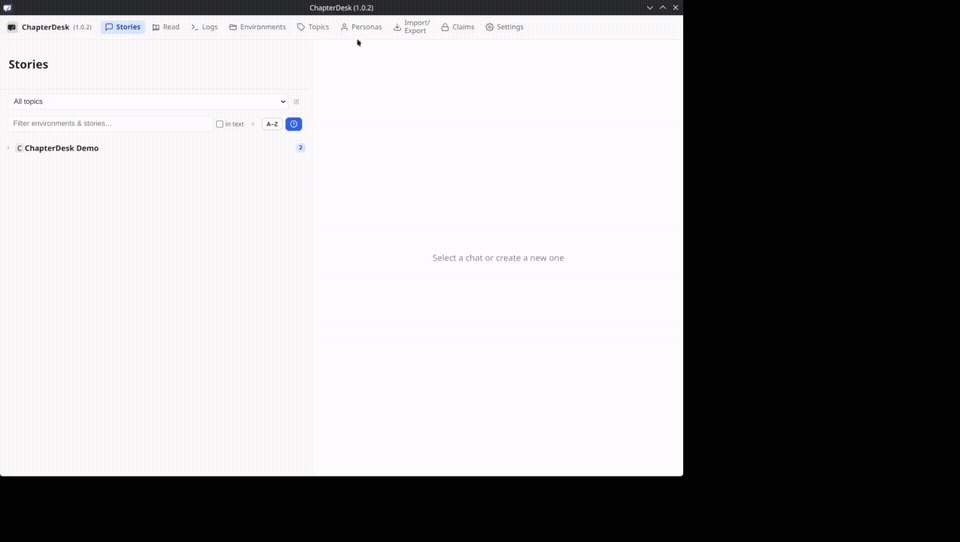

# Create a Topic, Environment and Story

Start a new writing workspace from scratch in one continuous flow: create a topic, add an environment, open a story, and enable the model you want to use.

| Time | Caption |
|------|---------|
| 0:00–0:02 | Open the **Topics** page |
| 0:02–0:06 | Click **+ New Topic** |
| 0:06–0:12 | Enter a name (here: “Immersive”) and create the topic |
| 0:12–0:15 | Switch to **Environments** and select the new topic |
| 0:15–0:18 | Click **+ New environment** |
| 0:18–0:25 | Name the environment (here: “Trips”) |
| 0:25–0:34 | Choose an emoji as avatar and create the environment |
| 0:34–0:37 | Return to **Stories** and expand the environment |
| 0:37–0:41 | Click **+** to create a new story |
| 0:41–0:44 | A new empty story opens |
| 0:44–0:48 | Open **Settings → Providers / Models** |
| 0:48–0:55 | Search for the model (here: “xiao…”) |
| 0:55–1:02 | Enable **Xiaomi: MiMo-V2.6-Pro-UltraSpeed** |
| 1:02–1:05 | The model is now available for writing |

A topic groups related environments. An environment holds the stories that share the same setting. Once the story is open you can write freely or use the chapter tools, and any enabled model can be selected.

---

### Tips

- You can create as many topics and environments as you like.
- An environment can have its own default model and greeting.
- Enabling a model is a one-time step; it stays available across stories.

**Related**

- [Provider & Model Setup](./provider-model-setup.md)
- [Chapter Headings and Elaboration](./chapter-headings-and-elaboration.md)
- [Write Your First Chapter](../manuals/manual-new-story.md)