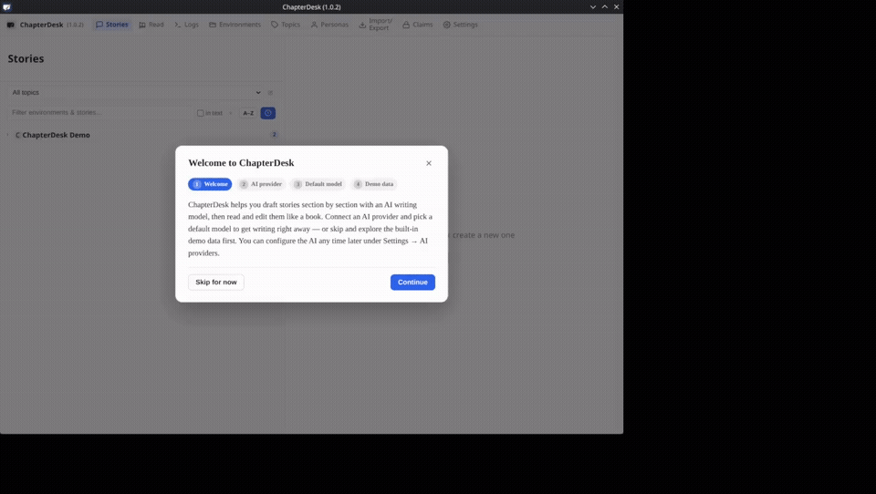
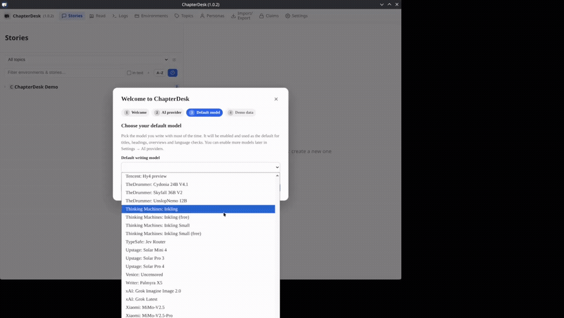

# Provider & Model Setup

Short clips showing the first-run wizard: connecting a provider and choosing a default model.

## 1. Connect a provider (OpenRouter example)

| Time | Caption |
|------|---------|
| 0:00–0:03 | Welcome to ChapterDesk — local writing studio for scene-by-scene stories |
| 0:03–0:06 | Connect an AI provider to start writing, or skip and explore the demo |
| 0:06–0:09 | Adding OpenRouter (one key, many models) |
| 0:09–0:12 | API key stays on your machine — only sent to the provider |
| 0:12–0:14 | Testing the connection… |
| 0:14–0:16 | Connection successful — fetching available models |

## 2. Choose default model & finish

| Time | Caption |
|------|---------|
| 0:00–0:02 | Choose your default writing model |
| 0:02–0:04 | Selected: Xiaomi MiMo-V2.6-Pro-UltraSpeed |
| 0:04–0:06 | Demo data is already loaded so you can explore immediately |
| 0:06–0:08 | Setup complete — start writing from the sidebar |
| 0:08–0:09 | ChapterDesk is ready |

---

**Notes**

- The API key is stored locally and only sent to the provider you configure.
- You can change the provider and default model later in Settings.
- Demo data is optional; you can start with an empty story instead.